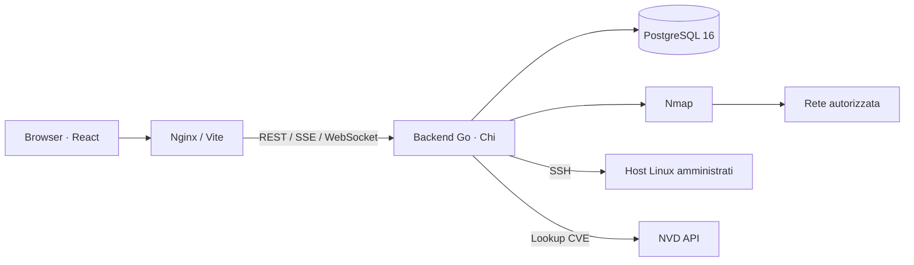

# NextGen-CyberSecurity

[](https://github.com/Alexx904/NextGen-CyberSecurity/actions/workflows/ci.yml)

**Conosci la rete, analizza le vulnerabilità e organizza le attività di sicurezza per azienda e reparto.**

NextGen-CyberSecurity è una piattaforma web Go/React multi-tenant che riunisce discovery LAN, scansioni Nmap, correlazione CVE, analisi euristica degli Attack Path, report e strumenti SSH. È pensata per assessment e amministrazione su infrastrutture autorizzate.

> Progetto in evoluzione. I manifest inclusi sono destinati allo sviluppo locale. Funzionalità implementate, evidenze e gate aperti sono registrati in [PROJECT_STATE](docs/PROJECT_STATE.md); le capacità pianificate sono distinte nella [roadmap](#roadmap).

Ultimo allineamento del README: 18 ottobre 2026.

## Indice

- [Funzionalità](#funzionalità)
- [Architettura e stack](#architettura-e-stack)
- [Avvio rapido con Docker](#avvio-rapido-con-docker)
- [Primo utilizzo](#primo-utilizzo)
- [Configurazione](#configurazione)
- [Sviluppo locale](#sviluppo-locale)
- [Test e verifiche](#test-e-verifiche)
- [GitHub Actions e immagini Docker](#github-actions-e-immagini-docker)
- [Struttura del repository](#struttura-del-repository)
- [Troubleshooting](#troubleshooting)
- [Sicurezza e limiti](#sicurezza-e-limiti)
- [Roadmap](#roadmap)
- [Documentazione e contributi](#documentazione-e-contributi)
- [Licenza](#licenza)

## Funzionalità

| Area | Capacità disponibili |
|---|---|
| Aziende e asset | Dashboard, selezione azienda, reparti, target IP e gerarchia a due livelli per le nuove scritture. |
| Network Discovery | Ricognizione LAN e arricchimento dell'identità host con informazioni di rete e probe HTTP; analisi porte opzionale. |
| Scansioni Nmap | Profili TCP, UDP, web, legacy, ACK e controlli NSE; editor entro allowlist, anteprima, pianificazione, avanzamento e confronto scansioni. |
| Vulnerability Intelligence | Catalogo CVE locale, lookup NVD e caching, correlazione con servizi e risultati NSE, consultazione dei finding. |
| Attack Path | Grafo 2D, percorsi modellati, priorità e chokepoint, con scope aziendale e guida integrata. |
| Report | Esportazioni PDF e CSV, viste executive e tecniche, dossier aziendale e dettaglio per reparto. |
| SSH e firewall | Inventario clienti indipendente dallo scope aziendale, pin host SHA256, terminale WebSocket e gestione iptables. |
| Diagnostica | Console di debug integrata ed esportazione Markdown con sanificazione delle credenziali. |

L'Attack Path rappresenta associazioni e ipotesi: non dimostra sfruttabilità, compromissione o movimento laterale. Le modifiche firewall e i meccanismi di rollback richiedono ancora il collaudo Linux descritto nei [limiti operativi](#sicurezza-e-limiti).

## Architettura e stack



| Livello | Tecnologie |
|---|---|
| Backend | Go 1.22, Chi, pgx/v5, JWT, bcrypt, gorilla/websocket, robfig/cron |
| Frontend | React 18, TypeScript 5.6, Vite 5, Tailwind CSS, Recharts, xterm.js |
| Persistenza | PostgreSQL 16, migrazioni SQL incorporate con coppie up/down |
| Assessment e report | Nmap, catalogo CVE locale/NVD, go-pdf/fpdf |
| Verifica e distribuzione | Go test/vet, Vitest, Testing Library, Docker Compose, GitHub Actions |

Il backend separa delivery HTTP, servizi, dominio, repository e scanner. Il frontend utilizza route protette, contesti per autenticazione e azienda e caricamento differito delle pagine. Contratti: [API](docs/03-architecture/LLD/API_SPEC.md), [schema database](docs/03-architecture/LLD/DATABASE_SCHEMA.md), [mappa domini](docs/03-architecture/DOMAIN_MAP.md).

## Avvio rapido con Docker

### Prerequisiti

- Git, Docker e Docker Compose v2.
- Su Windows: Docker Desktop in modalità container Linux.
- Accesso ai target autorizzati; la visibilità LAN dipende anche dalla rete dell'host e di Docker.

### Installazione

```powershell
git clone https://github.com/Alexx904/NextGen-CyberSecurity.git
cd NextGen-CyberSecurity
```

Facoltativamente copia `.env.example` in `.env` e personalizza localmente i valori prima dell'avvio. Compose usa il file per l'interpolazione; evita di versionare credenziali reali.

```powershell
$env:FRONTEND_PORT = "3080"
docker compose up -d --build
docker compose ps
```

| Servizio | Indirizzo predefinito |
|---|---|
| Interfaccia web | http://localhost:3080 |
| API REST | http://localhost:8080/api/v1 |
| Health backend | http://localhost:8080/api/v1/health |
| PostgreSQL | localhost:5432 |

Il backend attende PostgreSQL, applica le migrazioni e inizializza tenant e amministratore se necessari. Nmap è incluso nell'immagine backend; Compose assegna la capability `NET_RAW`.

Le credenziali iniziali di sviluppo sono definite da `ADMIN_EMAIL` e `ADMIN_PASSWORD` nel [manifest Compose](docker-compose.yml). Imposta valori propri prima del primo avvio: il seeding è idempotente e cambiare queste variabili non equivale a reimpostare un account già presente.

Il quickstart imposta `FRONTEND_PORT=3080` nel processo PowerShell. Puoi conservarla nel tuo `.env` locale; senza configurazione il manifest usa ancora il fallback 3000.

### Log e arresto

```powershell
docker compose logs --tail 100 backend frontend
docker compose stop
```

PostgreSQL conserva i dati nel volume `postgres_data`; il backend monta `backend/data`. Mantieni stabile il nome del progetto Compose negli aggiornamenti. Evita `docker compose down -v` come normale arresto: elimina i volumi persistenti.

## Primo utilizzo

1. Apri l'interfaccia e accedi con l'amministratore inizializzato.
2. Dalla dashboard crea o seleziona un'azienda, quindi organizza reparti e target.
3. Usa Network Discovery sul segmento autorizzato oppure inserisci i target da analizzare.
4. Avvia una scansione scegliendo il profilo, controlla anteprima e impatto, quindi segui avanzamento e risultati.
5. Consulta finding e Attack Path, conferma le evidenze tecniche e genera il report aziendale o per reparto.
6. Per gli strumenti SSH, configura separatamente l'host e il pin SHA256 verificato tramite un canale fidato.

Le pagine di assessment richiedono un'azienda attiva. Gli strumenti SSH sono accessibili indipendentemente da questa selezione.

## Configurazione

Il riferimento iniziale è [.env.example](.env.example); i nomi effettivamente letti dal backend sono definiti in [config.go](backend/internal/config/config.go). Non tutte le variabili vengono inoltrate dal Compose attuale.

| Variabili | Uso e ambito |
|---|---|
| `PORT`, `FRONTEND_PORT` | Porte locali; usa i default nel quickstart. Mapping interno backend e proxy sono configurati per 8080. |
| `APP_ENV` | Ambiente applicativo. |
| `DB_HOST`, `DB_PORT`, `DB_USER`, `DB_PASSWORD`, `DB_NAME`, `DB_SSLMODE` | Connessione PostgreSQL. Compose imposta host `postgres` e porta interna 5432; `DB_PORT` controlla la porta pubblicata sull'host. |
| `JWT_SECRET` | Segreto di firma JWT: sostituire il default fuori dal laboratorio locale. |
| `ADMIN_EMAIL`, `ADMIN_PASSWORD` | Identità iniziale dell'amministratore, lette dal server durante il seeding. |
| `SSH_MASTER_KEY` | Chiave per cifrare le credenziali SSH. Compose non la inoltra: predisporre un override di ambiente prima di un uso operativo e conservarla stabilmente. |
| `JWT_ACCESS_EXPIRATION_MINUTES`, `JWT_REFRESH_EXPIRATION_HOURS`, `BCRYPT_COST` | Parametri letti dal backend; non inoltrati dal Compose attuale. |
| `DB_MAX_CONNS`, `DB_MIN_CONNS` | Dimensionamento pool nel backend; non inoltrati dal Compose attuale. |

`JWT_EXPIRATION_MINUTES` compare nell'esempio ma non è il parametro letto dalla configurazione attuale: per l'esecuzione nativa usare i nomi access/refresh sopra. Il backend non carica automaticamente `.env`: nell'avvio nativo le variabili devono essere presenti nel processo.

Per configurazione operativa, backup, migrazioni e rollback consulta [Deployment](docs/06-devops/DEPLOYMENT.md). I default inclusi non costituiscono una configurazione di produzione.

## Sviluppo locale

Prerequisiti aggiuntivi: Go 1.22, Node.js 20 e npm, PostgreSQL 16 e Nmap disponibile nel `PATH` del backend.

### Backend

Predisponi un database di sviluppo e imposta le variabili nel processo, usando `DB_HOST=localhost` quando PostgreSQL è esposto localmente. Dalla root:

```powershell
cd backend
go mod download
go run ./cmd/server
```

Le migrazioni vengono applicate all'avvio: usa un database dedicato allo sviluppo. Dettagli in [Backend Setup](docs/04-development/BACKEND_SETUP.md).

### Frontend

In un altro terminale, dalla root:

```powershell
cd frontend
npm ci
npm run dev
```

Vite espone la UI sulla porta 3000 e inoltra API e WebSocket al backend sulla porta 8080. Lo stack Docker descritto nel quickstart espone invece la UI sulla porta 3080. Dettagli in [Frontend Setup](docs/04-development/FRONTEND_SETUP.md).

## Test e verifiche

### Comandi diretti

Da `backend`:

```powershell
go test ./...
go vet ./...
go build ./...
```

Da `frontend`:

```powershell
npm ci
npm test
npm run build
```

La build frontend include il controllo TypeScript. Il manifest corrente non definisce uno script lint frontend.

### Integrazione PostgreSQL

Il percorso rapido Go non verifica PostgreSQL. Prepara un database locale **dedicato ai test** e configura esplicitamente nel processo `TEST_DB_HOST`, `TEST_DB_PORT`, `TEST_DB_NAME`, `TEST_DB_USER` e `TEST_DB_PASSWORD`, poi da `backend`:

```powershell
go test -tags=integration -count=1 ./internal/repository/postgres
```

Configurazione o database mancanti producono un errore; non è previsto uno skip né il fallback sul database applicativo. Requisiti e protezioni sono nel [Test Plan](docs/05-qa/TEST_PLAN.md).

### Runner PowerShell

Dalla root, per il gate backend/frontend e, se configurata, l'integrazione dedicata:

```powershell
powershell -NoProfile -ExecutionPolicy Bypass -File scripts/verify.ps1 -Profile Final -Scope All
powershell -NoProfile -ExecutionPolicy Bypass -File scripts/verify.ps1 -Profile Final -Scope All -Integration
```

Per sole modifiche Markdown:

```powershell
powershell -NoProfile -ExecutionPolicy Bypass -File scripts/verify-agent-docs.ps1
git diff --check
```

I report del runner sono salvati in `.agent/artifacts/testing/`. I comandi elencati sono istruzioni riproducibili; gli esiti effettivamente raccolti sono registrati in [PROJECT_STATE](docs/PROJECT_STATE.md).

## GitHub Actions e immagini Docker

La [CI Pipeline](.github/workflows/ci.yml) definisce job backend, frontend e integrazione PostgreSQL. Solo dopo il loro successo costruisce le immagini Linux amd64 e prepara un artifact `nextgen-docker-linux-amd64-<sha>`, conservato per 7 giorni. Non pubblica automaticamente su un registry e non effettua deploy.

Quando disponibile, scarica ed estrai l'artifact dalla pagina [Actions](https://github.com/Alexx904/NextGen-CyberSecurity/actions). Dalla cartella estratta:

```powershell
Get-FileHash .\nextgen-images.tar.gz -Algorithm SHA256
# Confrontare il risultato con SHA256SUMS prima di caricare le immagini.
docker load --input nextgen-images.tar.gz
$env:FRONTEND_PORT = "3080"
docker compose -f docker-compose.yml -f compose.images.yml up -d --no-build
```

Il pacchetto include immagini backend/frontend, manifest, checksum e revisione; PostgreSQL viene scaricato separatamente. Per aggiornare un'installazione mantieni directory/nome progetto e configurazione originali. Disponibilità ed esito di una specifica esecuzione vanno verificati su Actions. Dettagli nella [pipeline CI/CD](docs/06-devops/CI_CD_PIPELINE.md).

## Struttura del repository

```text
NextGen-CyberSecurity/
├── backend/
│   ├── cmd/                    # Server e utility cve-sync
│   ├── internal/               # Config, dominio, delivery, servizi, repository, scanner
│   └── pkg/                    # Componenti condivisi e generazione report
├── frontend/
│   └── src/                    # Pagine, componenti, contesti, API, tipi e test
├── docs/                       # Fonti di prodotto, architettura, QA e procedure agentiche
├── scripts/                    # Runner di verifica e controlli documentali
├── .github/workflows/          # GitHub Actions
├── .agent/                     # Ruoli, playbook ed evidenze locali ignorate da Git
├── docker-compose.yml          # Stack locale con build dai sorgenti
├── compose.images.yml          # Override per immagini prodotte dalla CI
├── .env.example                # Esempio di configurazione locale
└── AGENTS.md                   # Contratto operativo per gli agenti
```

## Troubleshooting

| Sintomo | Controllo consigliato |
|---|---|
| UI o API non disponibili | Verifica `docker compose ps`, health backend, log e disponibilità delle porte 3080/8080/5432 per lo stack Docker del quickstart; Vite nativo usa 3000. |
| Backend non healthy | Controlla PostgreSQL, configurazione e log delle migrazioni; evita reset automatici del volume. |
| Discovery incompleta o target irraggiungibile | Verifica route dal backend/container, firewall e limiti del bridge Docker; la raggiungibilità dal PC non garantisce quella dal container. |
| Scansione lenta o ETA assente | Filtraggio, UDP, NSE e dimensione dello scope influenzano la durata; le ETA sono euristiche, non SLA. |
| SSH rifiutato per pin | Verifica il fingerprint host SHA256 tramite canale fidato; distinguilo dal fingerprint della chiave client. |
| Terminale WebSocket non connesso | Controlla il proxy `/ws/` e gli header Upgrade; ricostruisci il frontend se Nginx è precedente al fix. |
| Firewall HTTP 502 | Leggi il messaggio API: sul target servono iptables e privilegi root o sudo non interattivo. Il login SSH da solo non prova questi prerequisiti. |
| Test DB falliti per configurazione | Imposta tutte le `TEST_DB_*` su un database locale dedicato e usa il tag `integration`. |

## Sicurezza e limiti

- Esegui scansioni e comandi remoti solo su sistemi autorizzati. NSE e alcuni profili possono avere impatto sui servizi.
- Le correlazioni CVE derivate da versioni, banner e CPE richiedono verifica, anche in presenza di backport.
- Il consenso alle scansioni è presente in UI; attestazione immutabile e imposizione server restano un debito aperto (`TECH-DEBT-05`).
- Il pin host SSH è implementato e blocca pin assenti o discordanti. Il collaudo visuale dell'hardening resta aperto; un timeout locale non garantisce la terminazione del comando remoto.
- Watchdog, rollback firewall, disconnessioni e coordinamento multiistanza richiedono ulteriore verifica Linux (`TECH-DEBT-07`). La remediation chokepoint è un incremento parziale con gate operativo aperto.
- Le build precedenti hanno segnalato advisory nelle dipendenze frontend (`TECH-DEBT-09`); analisi e aggiornamenti sono nel backlog, senza attestazione di sfruttabilità.
- Prima di un'esposizione operativa definisci TLS, gestione dei segreti, accessi di rete, backup/ripristino, monitoraggio e rollback. Conserva la chiave SSH di cifratura con i dati che protegge.

L'accettazione delle funzionalità non equivale a una certificazione di sicurezza o conformità. Consulta [task e debito tecnico](docs/04-development/TASK_LIST.md) e [stato progetto](docs/PROJECT_STATE.md) per evidenze e limiti aggiornati.

## Roadmap

| Area | Stato |
|---|---|
| Assessment, asset, report, CVE e Attack Path | Implementati; evidenze e limiti registrati nei documenti di dominio. |
| Hardening SSH | Pinning e deadline implementati; gate visuale e verifiche remote residue aperti. |
| Active Defense & SOAR Light | In corso: incremento backend chokepoint; UI, virtual patching e alerting multicanale pianificati. |
| Continuous Compliance | Pianificata: mapping NIS2/DORA/ISO 27001, scorecard e dossier. |
| AI Remediation Copilot | Pianificato: playbook, sintesi executive e assistente infrastrutturale. |

Priorità e criteri di completamento sono nella [task list](docs/04-development/TASK_LIST.md). Lo storico degli incrementi accettati è nel [CHANGELOG](CHANGELOG.md).

## Documentazione e contributi

- [Indice documentale](docs/README.md): fonti canoniche e regole di consultazione.
- [Architettura](docs/03-architecture/HLD.md) e [domini](docs/03-architecture/DOMAIN_MAP.md): struttura e comportamento.
- [Test Plan](docs/05-qa/TEST_PLAN.md): strategia di verifica.
- [Deployment](docs/06-devops/DEPLOYMENT.md): installazione, aggiornamenti e limiti operativi.
- [AGENTS.md](AGENTS.md) e [playbook](.agent/README.md): workflow del repository.

Per segnalare un problema, includi revisione, ambiente, riproduzione, risultato atteso ed effettivo e log sanificati. Non allegare credenziali, token o dati sensibili dei target. Per contribuire, mantieni il cambiamento circoscritto, aggiungi verifiche pertinenti e aggiorna i contratti interessati; consulta `AGENTS.md` prima di modificare il progetto.

## Licenza

Il repository attualmente non contiene un file `LICENSE`. Non è dichiarata una licenza open source: chiarisci i termini con il titolare prima di riutilizzare o redistribuire il codice. Le dipendenze mantengono le rispettive licenze.
