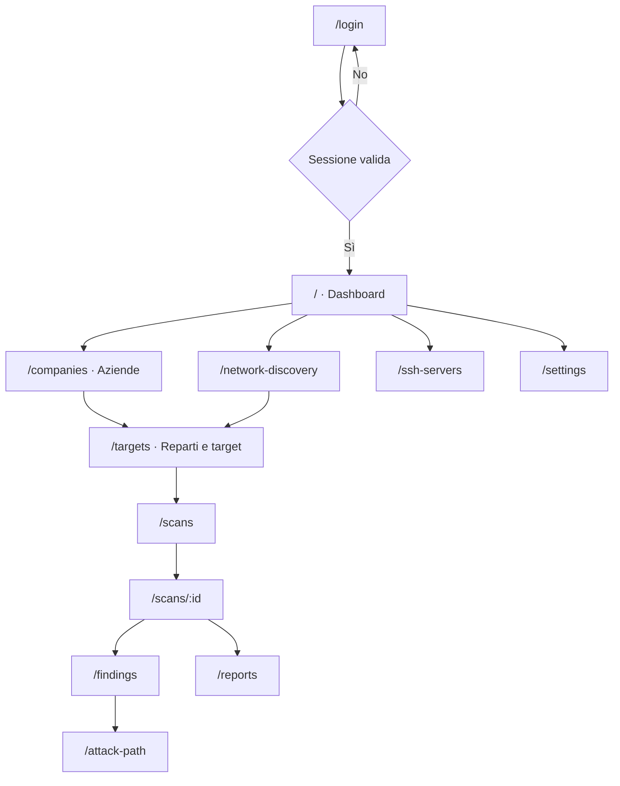

# UX Flow

> Responsabile: UI/UX Designer. Navigazione verificata in `frontend/src/App.tsx`; flussi di dominio derivati dalle specifiche esistenti.

Le frecce dopo il login descrivono il percorso operativo, non redirect automatici o link obbligatori. Il selettore azienda determina il contesto trasversale.

Per modifiche UX aggiornare il solo flusso interessato, includendo empty/loading/error, autorizzazioni, conferme e annullamento. Verificare il risultato con browser e screenshot quando disponibile; il diagramma non sostituisce la prova visuale.
