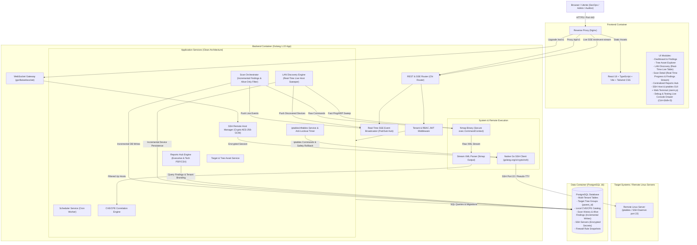

# High-Level Design

> Responsabile: Software Architect. Architettura ereditata; migrazione strutturale 2026-10-15.

## 1. Diagramma Architetturale di Sistema

La piattaforma adotta un'architettura containerizzata multi-servizio Clean Architecture con disaccoppiamento tra il layer API REST/SSE/WebSocket, il motore di ricognizione/scansione Nmap, il gestore di connessioni SSH sicure e firewall, il database relazionale PostgreSQL e la Single Page Application (SPA).

Allineamento scanner 2026-10-15 (working tree, SCAN-UX-01): profili espliciti ed editor Nmap nella modale, senza matching per nome o compositore duplicato. Parser semantico e classificazione custom nel backend, API/DB compatibili; [contratto di dominio](../domains/scanning_and_discovery.md). Discovery distingue host discovery e arricchimento porte richiesto. Decisione in [ADR-14](ADR/README.md#adr-14).

Allineamento 2026-10-16 (SCAN-TIME-01): statistiche XML periodiche Nmap → callback runner → snapshot attivi/SSE → monitor lotto con polling batch autenticato. Nessun cambiamento DB, dettagli in [API_SPEC](LLD/API_SPEC.md) e [piano](../04-development/SCAN_PROGRESS_PLAN.md). Snapshot in memoria eliminati a fine job; ETA dichiaratamente euristica, non timeout né promessa di durata.



---

## 2. Stack Tecnologico Completo

| Componente | Tecnologia | Versione / Note |
| :--- | :--- | :--- |
| **Backend Language** | **Golang** | `1.22+` (Goroutine, worker pool, type safety) |
| **HTTP Router & SSE** | **go-chi/chi/v5** + `http.Flusher` | Router HTTP snello con supporto nativo Server-Sent Events (`text/event-stream`) |
| **WebSocket Gateway** | **gorilla/websocket** | Gateway WebSocket dedicato per il terminale remoto interattivo PTY |
| **Event Broadcaster** | **In-Memory Pub/Sub Hub Go** | Canali Go bufferizzati con multiplexing per tenant/sessione e safety timeout |
| **SSH Client Nativo** | **golang.org/x/crypto/ssh** | Client SSH Go conforme RFC 4251 con supporto chiavi RSA/Ed25519 e password |
| **Crittografia a Riposo** | **Crypto AES-256-GCM** | Cifratura autenticata hardware-accelerata per credenziali SSH |
| **Database & Driver** | **PostgreSQL 16** + **jackc/pgx/v5** | Relational DB con supporto JSONB, indici B-Tree e salvataggio incrementale findings |
| **Database Migrations** | **golang-migrate/migrate/v4** | Migrazioni SQL versionate e riproducibili |
| **Network Scanner** | **Nmap** (containerizzato) | `7.94+` con flag minimi di privilegio e parsing streaming |
| **Task Scheduling** | **robfig/cron/v3** | Cron scheduler in-memory con persistenza DB |
| **PDF Reporting** | **jung-kurt/gofpdf** | Generatore nativo PDF (layout Executive e Tecnico) |
| **Frontend Framework** | **React 18** + **TypeScript** | Web UI reattiva modulare |
| **Build Tool Frontend** | **Vite 5+** | Bundling veloce, HMR e build ottimizzata |
| **Live Stream Client** | **Native EventSource / Fetch SSE** | Connessione stream persistente con riconnessione automatica e parsing eventi |
| **Terminale Web** | **@xterm/xterm** + **@xterm/addon-fit** | Emulatore terminale ANSI ad alte prestazioni nel browser |
| **Debug & Diagnostics** | **Custom Ring-Buffer Logger + Interceptors** | Cattura trasparente chiamate Axios, eventi SSE, WebSocket ed eccezioni JS con export Markdown |
| **UI & Styling** | **Tailwind CSS** + **Lucide Icons** | Design system moderno con dark mode nativo e grafici **Recharts** |
| **Containerization** | **Docker & Docker Compose** | Multi-container: `postgres`, `backend` (con Nmap), `frontend` (con Nginx) |

---

## 3. Design Pattern e Struttura del Codice (Clean Architecture)

```
backend/
├── cmd/
│   ├── server/             # Entrypoint applicazione principale (main.go)
│   └── cve-sync/           # Utility CLI per sincronizzare il database CVE locale
├── internal/
│   ├── domain/             # Entità di business pure, errori di dominio e interfacce
│   ├── repository/         # Implementazione persistenza dati PostgreSQL (SQL/pgx)
│   │   ├── postgres/       # Repository concreti per entità
│   │   └── migrations/     # File di migrazione .sql versionati
│   ├── service/            # Casi d'uso e logica di business
│   ├── scanner/            # Wrapper Nmap, parser XML e profili (Alive-Only)
│   └── delivery/           # Handlers HTTP REST, SSE, WebSocket e Middleware
└── pkg/
    ├── crypto/             # AES-256-GCM encryption/decryption helper
    ├── auth/               # JWT token & Password Hasher
    ├── report/             # Generatori PDF e CSV
    └── validator/          # Validatore IP/CIDR/Porte/Firewall rules
```

---

## Documenti tecnici

E28-S1-T1 (2026-10-17, working tree): DefenseService collega il grafo corrente al
gestore firewall esistente; handler SecOps/admin e DTO additivi, nessuna nuova
dipendenza o tabella. Dettagli nel [dominio Active Defense](../domains/active_defense_and_soar.md).

- [API e streaming](LLD/API_SPEC.md)
- [Schema database](LLD/DATABASE_SCHEMA.md)
- [Componenti e interazioni](LLD/COMPONENT_DESIGN.md)
- [Mappa del codice e domini](DOMAIN_MAP.md)
- [Decisioni tecniche](ADR/README.md)
