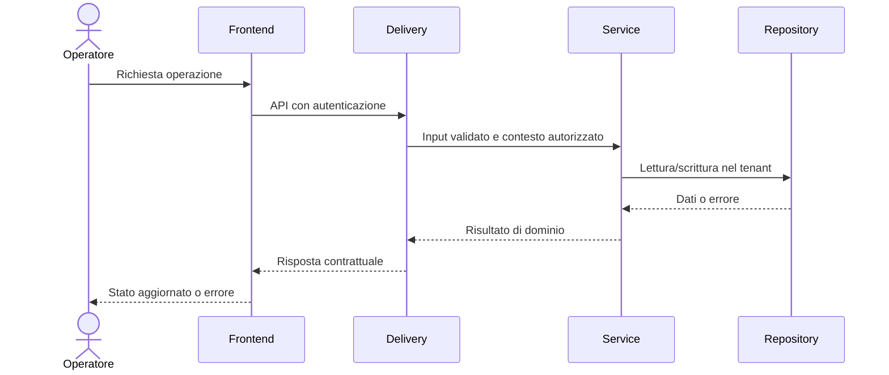

# Component Design

> Responsabile: Lead Developer; revisione Software Architect. Dettagli di tipi, interfacce e algoritmi restano nei domini collegati da [DOMAIN_MAP](../DOMAIN_MAP.md).

## Confini

Backend: domain → service → repository/scanner/integrazioni, esposti tramite delivery HTTP/SSE/WS. Frontend: route e componenti → hook/context → client API. Il contratto dati è definito in [API_SPEC](API_SPEC.md); la persistenza in [DATABASE_SCHEMA](DATABASE_SCHEMA.md).

## LLD per feature

Prima del codice documentare nel piano o nel dominio: file e firme reali, input/output, invarianti, errori, autorizzazioni, transazioni, cancellazione/concorrenza, dipendenze e test. Non creare diagrammi di classi artificiali per codice Go o componenti funzionali React.
