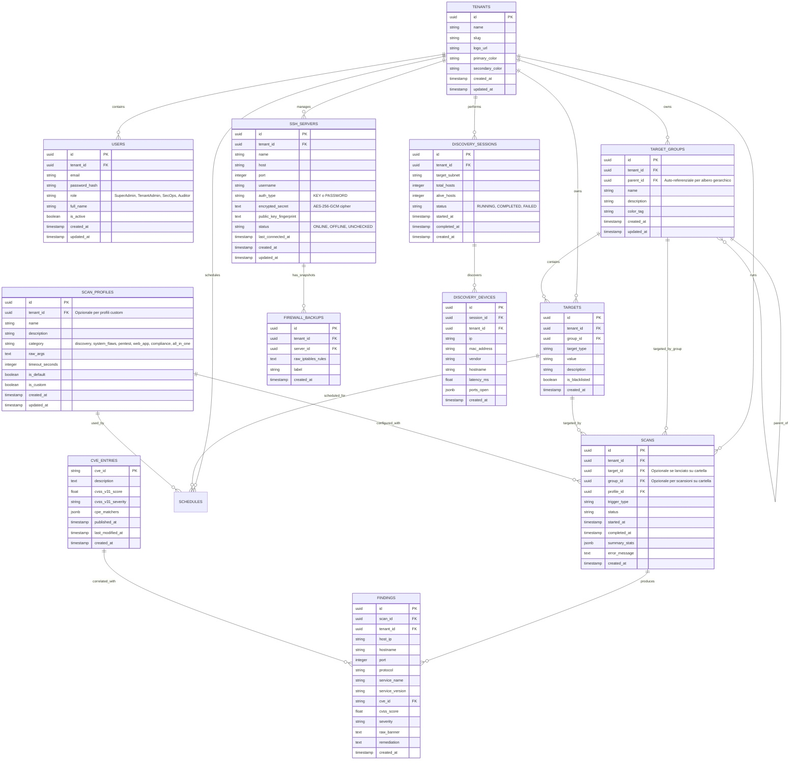

# Database Schema

> Responsabile: Lead Developer; revisione Software Architect. Schema descrittivo migrato, non nuova verifica del database.
> Fonte eseguibile: migrazioni versionate in `backend/internal/repository/migrations/`. Aggiornare questo documento con ogni modifica dello schema.

## 4. Schema Database (ERD Esteso)

---
