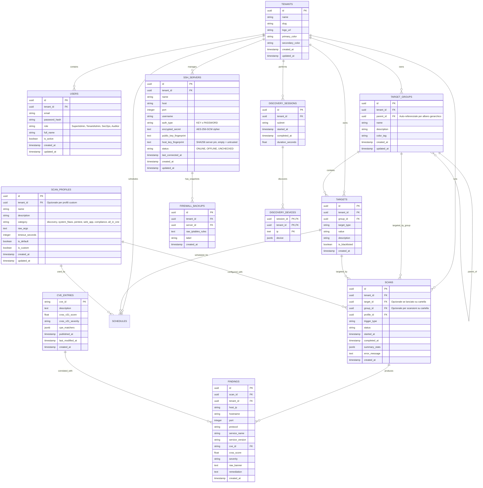

# Database Schema

> Publication scope 2026-10-18: alert-channel / outbox / migration 000012 sections describe deferred T4/T5 design and local prototype evidence. Their code and routes are excluded from this release; published migration is 000011. Alert-specific commands are future gates.

> Responsabile: Lead Developer; revisione Software Architect. Schema descrittivo migrato, non nuova verifica del database.
> Fonte eseguibile: migrazioni versionate in `backend/internal/repository/migrations/`. Aggiornare questo documento con ogni modifica dello schema.

## 4. Schema Database (ERD Esteso)

E28-S1-T4 · 2026-10-18 · working tree: `000012` adds `alert_channels`
(tenant, optional root company, provider, enabled/events, encrypted config,
created/updated/deleted timestamps), `alert_observations` (tenant/entity key,
normalized identity signature) and `alert_jobs` (event payload, state, attempts,
next attempt, lease/token and redacted result code). Composite tenant/channel
and tenant/company foreign keys prevent cross-tenant references. Company FK
uses deferred NO ACTION so a tenant cascade can remove all owned data; removing
an in-use company alone fails. Guard triggers reject reparenting a company with
non-deleted channels. Deleting a channel soft-deletes metadata, disables it,
clears company/config and preserves delivery history. Pending old messages are
cancelled on relevant configuration changes; in-flight requests may complete.

Finding/discovery/scheduled terminal-status triggers enqueue in the source
transaction. Observation locks serialize source writes per tenant, with no new
messages for unchanged findings or latency/time/port-order-only updates. Existing
history is baselined at migration time without notifications. Delivery is
at-least-once with six attempts and 30-second leased claims; token/revision
checks reject stale ownership. Claim index covers pending/sending due times.
No automatic retention purge or production-scale migration benchmark is claimed.
Down drops only alert tables/triggers/functions and its composite company index;
it destroys alert config/observations/history, cannot recall sent messages and
requires a backup of the three tables for application rollback. Up/down/up is
tested only on the disposable local `nextgen_discovery_test` database.
[Contract/evidence](../../04-development/plans/E28-S1-T4-alerting.md), ADR-26.

M11-PERSIST-01 · 2026-10-18 · working tree: `000011` aggiunge
`discovery_sessions` e `discovery_devices`. ID sessione globale univoco;
FK composta `(tenant_id, session_id)` impedisce dispositivi di tenant diversi.
Un dispositivo JSONB per IP (`INET`), upsert durante la scansione; metadati e
dispositivi letti con un unico snapshot SQL. Indice tenant/data/ID per l'ultima
sessione, anche parziale; nessuno stato COMPLETED inferito da un riavvio.
CASCADE tenant→sessioni→dispositivi intenzionale per dati posseduti dal tenant.
Down rimuove solo le due nuove tabelle e perde lo storico discovery: eseguire
backup di entrambe prima di rollback applicativi. Prove solo sul DB sacrificabile
`nextgen_discovery_test`, porta locale 55432; [piano](../../04-development/plans/M11-PERSIST-01.md).

TEST-OPT-01 · Ultimo allineamento 2026-10-17 · working tree: schema e migrazioni invariati. Test repository PostgreSQL con tag `integration`, configurazione `TEST_DB_*` esclusiva su host locale e database dedicato `_test`/`_test_<id>`; nessun fallback su DB applicativo e indisponibilità = FAIL. Percorso rapido senza DB. Contratto operativo e comandi nel [Test Plan](../../05-qa/TEST_PLAN.md).

COMPANY-UX-02 · 2026-10-17 · working tree: `000008` aggiunge `ssh_servers.client_name VARCHAR(160) NOT NULL DEFAULT ''`, senza FK aziendale. `000009` aggiunge trigger `company_department_depth` e funzione associata: nuove scritture parent solo sotto radice del tenant, nodo con figli non spostabile sotto radice. Lock advisory transazionale per tenant sulle assegnazioni parent, nessuna migrazione dati legacy. Down 000009 rimuove trigger/funzione; down 000008 rimuove le etichette cliente. Up/down verificati solo sul DB dedicato `nextgen_company_ux02_test_20261017`.

AP-REVIEW-01 · 2026-10-17 · working tree: schema invariato, nessuna migrazione. Le letture paginate dei target aggiungono `id ASC` come spareggio a `created_at DESC`; i finding aggiungono `id ASC` dopo severità/porta. Ordinamento stabile a dati fermi, senza garanzia di snapshot consistente durante scritture concorrenti. Serve a evitare perdita/duplicazione per pareggi nella costruzione del [grafo euristico](../../domains/attack_path.md).

---

## TECH-DEBT-05 - Authorization evidence (2026-10-19, working tree)

Migration `000013_scan_authorization` adds nullable `consent_snapshot JSONB` to
`scans` and `schedules`. Null preserves historical reads without fabricating
consent; application services/workers reject covered execution without evidence.
The public JSON name is `authorization`. Snapshots contain the versioned explicit
statement, exact target IDs/values, Nmap arguments, timeout, recurrence, tenant,
actor and server acceptance time; recurring evidence also records schedule ID.
Source snapshot changes are rejected by triggers; status/timestamps remain mutable.

`scan_authorization_audit`: UUID primary key, tenant/user UUIDs, object type
(scans/schedules), object UUID, database-generated recorded_at and evidence JSONB;
unique (object_type, object_id), index (tenant_id, recorded_at DESC, id). No inventory
FK is intentional: evidence survives scan/schedule/tenant deletion. Source inserts
and audit insertion share the source transaction. UPDATE/DELETE/TRUNCATE evidence
operations are rejected; PUBLIC mutation privileges are revoked. A database owner
can remove triggers; this is application-level immutability, not external notarization.
No automatic retention/purge policy or unlimited storage claim is introduced.

Runtime schedule writes update only last/next-run timestamps conditionally on the
same enabled schedule/configuration, never overwriting concurrent disable/edit.
Down removes the two snapshot columns, new audit table, triggers and functions;
it loses authorization history. Back up those columns/table before application
rollback. Up/down/up tests use only disposable `nextgen_consent_test` on 55432.
Migration 000012 remains the preexisting deferred alerting prototype; no release
or deployment of that work is implied by testing the integrated local tree.
[ADR-27](../ADR/README.md#adr-27--inventory-scan-authorization-snapshots-2026-10-19),
[implementation and evidence](../../04-development/plans/TECH-DEBT-05.md).
