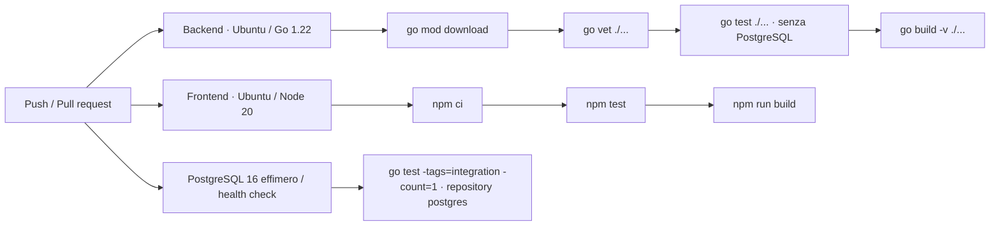

# CI/CD Pipeline

> Responsabile: DevOps Engineer. Fonte eseguibile: `.github/workflows/ci.yml`.

La pipeline parte su push a `main`, `feat/**`, `fix/**`, `chore/**`, pull request verso `main` e avvio manuale `workflow_dispatch`.

Ultimo allineamento: 2026-10-17 · working tree · TEST-OPT-01. Permessi `contents: read`; concurrency per workflow/evento/ref cancella esecuzioni obsolete dello stesso evento. Push e PR rimangono controlli distinti, perché la PR può verificare il merge sintetico. Nessun filtro automatico per percorsi: le modifiche a sicurezza o contratti condivisi restano coperte.

I tre job backend, frontend e integration sono indipendenti e possono eseguire in parallelo. Cache Go per dipendenze/build, cache npm per download; `npm ci` resta necessario. Il job integration ha timeout di 10 minuti, PostgreSQL `16-alpine` con DB `nextgen_ci_test`, porta host dinamica e health check. I parametri `TEST_DB_*` sono espliciti; la password nel workflow è un valore sintetico del servizio effimero, non una credenziale applicativa. Database non raggiungibile o configurazione assente fanno fallire il job, senza skip. `-count=1` impedisce riuso di risultati dipendenti dallo stato DB.

La pipeline non esegue deploy, tag/release, browser E2E, rollback migrazioni o controllo automatico Markdown. I test rapidi non dimostrano integrazione PostgreSQL. Le durate degli step sono disponibili in Actions; localmente il [runner](../../scripts/verify.ps1) registra durate ed exit code in `.agent/artifacts/testing/`. La policy di verifica locale selettiva e i criteri di riuso sono nel [Test Plan](../05-qa/TEST_PLAN.md). Non rilanciare suite locali già valide per una sola modifica Markdown; non sostituire evidenze di un ambiente con quelle di un altro.

Il servizio segue il modello ufficiale [PostgreSQL service containers](https://docs.github.com/en/actions/tutorials/use-containerized-services/create-postgresql-service-containers); il nuovo workflow deve essere validato su GitHub dopo un push esplicitamente autorizzato. Nessuna esecuzione remota è implicita nella verifica locale.

Aggiornare questo documento insieme al workflow. L'aggiunta di pubblicazione o deploy richiede definizione di ambiente e autorizzazioni; un push non è implicito nella richiesta di sviluppo.

## DOCKER-CI-01 · Pacchetto scaricabile

Ultimo allineamento: 2026-10-17 · working tree. Contratto: il job `docker` dipende dal successo di backend, frontend e integration; costruisce immagini Linux amd64 dai Dockerfile esistenti, senza registry o deploy. Le stesse verifiche precedono anche l'avvio manuale. Permessi globali invariati `contents: read`, nessun secret aggiuntivo.

Le immagini `nextgen-backend:ci` e `nextgen-frontend:ci` includono la label OCI della revisione. Un artifact `nextgen-docker-linux-amd64-<sha>` conserva per 7 giorni l'archivio compresso `nextgen-images.tar.gz`, checksum SHA256, `REVISION.txt`, Compose base e override immagini. PostgreSQL non è incluso nell'archivio e viene scaricato da Compose. Le immagini sono utilizzabili su Docker Desktop Windows in modalità container Linux; non sono eseguibili Windows e non costituiscono un pacchetto completamente offline.

I contesti Docker escludono `.env*`, chiavi/certificati, dati backend e output locali. La build frontend usa `npm ci` sul lockfile. I tag `:ci` sono locali e vengono sostituiti caricando un altro artifact: usare archivio e manifest della medesima esecuzione. Procedura di caricamento in [Deployment](DEPLOYMENT.md#docker-ci-01--caricamento-artifact).

Verifica prevista: build locale delle due immagini, controllo Nmap e configurazione Nginx in container isolati, esportazione/caricamento archivio, risoluzione Compose senza leggere `.env`, verificatore Markdown e diff. Nessun avvio dello stack applicativo o accesso a DB/target. L'orchestrazione Actions e l'upload richiedono una prima esecuzione remota dopo push autorizzato e non sono provati dalle build locali.

Evidenze locali 2026-10-17, dalla root, tutti exit 0:

| Comando / scope | Esito e durata osservata |
|---|---|
| `docker build --platform linux/amd64 --tag nextgen-backend:ci ./backend` | PASS, 9,15 s wall; compilazione Go 7,4 s |
| `docker build --platform linux/amd64 --tag nextgen-frontend:ci ./frontend` | PASS; preparazione npm 9,3 s, typecheck/build 14,0 s (tempi step Docker, totale non misurato) |
| `docker run --rm --network none --entrypoint nmap nextgen-backend:ci --version` e `docker run --rm --network none --add-host backend:127.0.0.1 nextgen-frontend:ci nginx -t` | PASS, 0,84 s combinati; nessuna scansione o connessione backend |
| `docker save --output .agent/artifacts/docker-ci-01/nextgen-images.tar nextgen-backend:ci nextgen-frontend:ci` | PASS, 0,92 s; compressione GZip .NET e hash locale 1,17 s |
| `docker load --input .agent/artifacts/docker-ci-01/nextgen-images.tar.gz` | PASS, 3,54 s; entrambe le immagini caricate |
| `docker compose --env-file .env.example -f docker-compose.yml -f compose.images.yml config --quiet` | PASS; durata individuale non raccolta |

I primi tentativi build nella sandbox sono falliti exit 1 per accesso alla configurazione Docker; ripetuti con escalation autorizzata. Nessuna configurazione/credenziale letta esplicitamente. I sorgenti applicativi restano invariati: non si attribuiscono nuove evidenze di suite applicative alle sole build. `npm ci` ha segnalato 16 vulnerabilità: registrate come TECH-DEBT-09, senza fix automatici o conclusioni sulla sfruttabilità.
