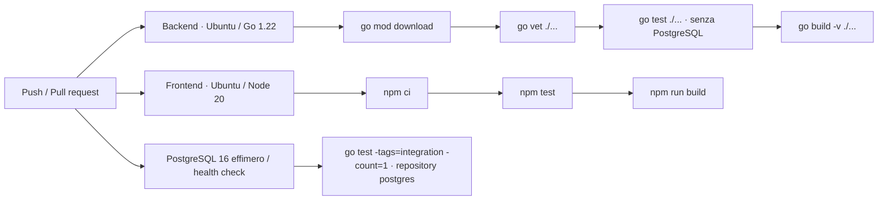

# CI/CD Pipeline

> Responsabile: DevOps Engineer. Fonte eseguibile: `.github/workflows/ci.yml`.

La pipeline esistente parte su push a `main`, `feat/**`, `fix/**`, `chore/**` e pull request verso `main`.

Ultimo allineamento: 2026-10-17 · working tree · TEST-OPT-01. Permessi `contents: read`; concurrency per workflow/evento/ref cancella esecuzioni obsolete dello stesso evento. Push e PR rimangono controlli distinti, perché la PR può verificare il merge sintetico. Nessun filtro automatico per percorsi: le modifiche a sicurezza o contratti condivisi restano coperte.

I tre job backend, frontend e integration sono indipendenti e possono eseguire in parallelo. Cache Go per dipendenze/build, cache npm per download; `npm ci` resta necessario. Il job integration ha timeout di 10 minuti, PostgreSQL `16-alpine` con DB `nextgen_ci_test`, porta host dinamica e health check. I parametri `TEST_DB_*` sono espliciti; la password nel workflow è un valore sintetico del servizio effimero, non una credenziale applicativa. Database non raggiungibile o configurazione assente fanno fallire il job, senza skip. `-count=1` impedisce riuso di risultati dipendenti dallo stato DB.

La pipeline non esegue deploy, tag/release, browser E2E, rollback migrazioni o controllo automatico Markdown. I test rapidi non dimostrano integrazione PostgreSQL. Le durate degli step sono disponibili in Actions; localmente il [runner](../../scripts/verify.ps1) registra durate ed exit code in `.agent/artifacts/testing/`. La policy di verifica locale selettiva e i criteri di riuso sono nel [Test Plan](../05-qa/TEST_PLAN.md). Non rilanciare suite locali già valide per una sola modifica Markdown; non sostituire evidenze di un ambiente con quelle di un altro.

Il servizio segue il modello ufficiale [PostgreSQL service containers](https://docs.github.com/en/actions/tutorials/use-containerized-services/create-postgresql-service-containers); il nuovo workflow deve essere validato su GitHub dopo un push esplicitamente autorizzato. Nessuna esecuzione remota è implicita nella verifica locale.

Aggiornare questo documento insieme al workflow. L'aggiunta di pubblicazione o deploy richiede definizione di ambiente e autorizzazioni; un push non è implicito nella richiesta di sviluppo.
