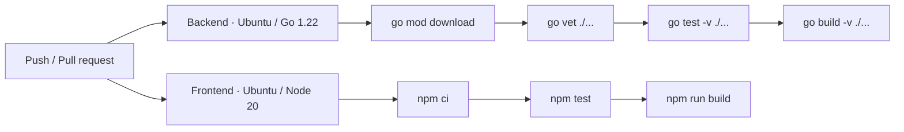

# CI/CD Pipeline

> Responsabile: DevOps Engineer. Fonte eseguibile: `.github/workflows/ci.yml`.

La pipeline esistente parte su push a `main`, `feat/**`, `fix/**`, `chore/**` e pull request verso `main`.

I job backend e frontend sono indipendenti. La pipeline non dichiara servizi PostgreSQL, deploy, tag/release, browser E2E o controllo automatico dei Markdown. Il nome di uno step non dimostra che tutte le integrazioni siano realmente esercitate: verificare prerequisiti e skip nei test.

Aggiornare questo documento insieme al workflow. L'aggiunta di pubblicazione o deploy richiede definizione di ambiente e autorizzazioni; un push non è implicito nella richiesta di sviluppo.
