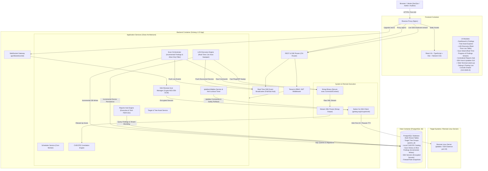
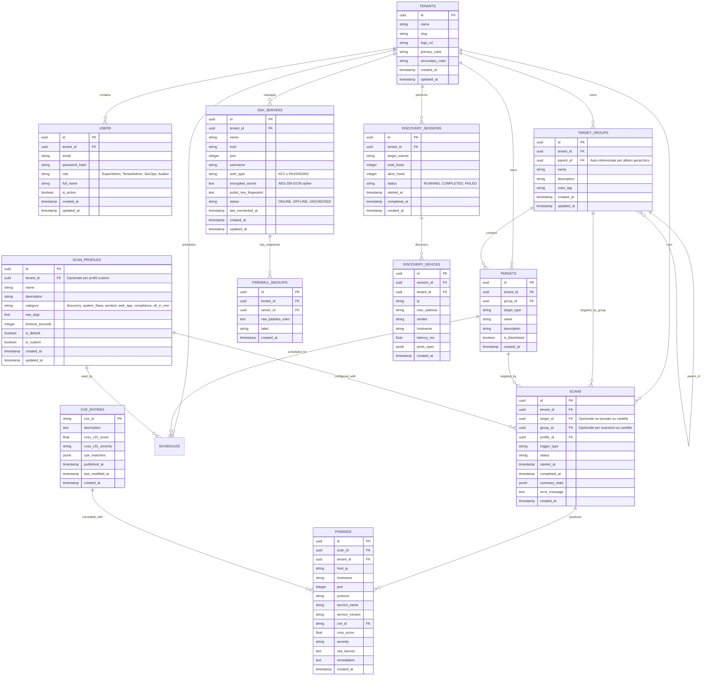

# 2. System Architecture & Technical Specifications

> **Stato:** APPROVATO (Fase 2: System Design - Struttura Autonoma v6.0)  
> **Ultimo Aggiornamento:** 2026-10-09  
> **Autore / Ruolo:** TechLead-Engineer-Agent (System Architect)  
> **Documenti Correlati:** [0_REQUIREMENTS.md](file:///c:/Users/aless/Desktop/Sviluppo/GitHub/NextGen-CyberSecurity/docs/0_REQUIREMENTS.md) | [1_PROJECT_CONTEXT.md](file:///c:/Users/aless/Desktop/Sviluppo/GitHub/NextGen-CyberSecurity/docs/1_PROJECT_CONTEXT.md)

---

## 1. Diagramma Architetturale di Sistema

La piattaforma adotta un'architettura containerizzata multi-servizio Clean Architecture con disaccoppiamento tra il layer API REST/SSE/WebSocket, il motore di ricognizione/scansione Nmap, il gestore di connessioni SSH sicure e firewall, il database relazionale PostgreSQL e la Single Page Application (SPA).



---

## 2. Stack Tecnologico Completo

| Componente | Tecnologia | Versione / Note |
| :--- | :--- | :--- |
| **Backend Language** | **Golang** | `1.22+` (Goroutine, worker pool, type safety) |
| **HTTP Router & SSE** | **go-chi/chi/v5** + `http.Flusher` | Router HTTP snello con supporto nativo Server-Sent Events (`text/event-stream`) |
| **WebSocket Gateway** | **gorilla/websocket** | Gateway WebSocket dedicato per il terminale remoto interattivo PTY |
| **Event Broadcaster** | **In-Memory Pub/Sub Hub Go** | Canali Go bufferizzati con multiplexing per tenant/sessione e safety timeout |
| **SSH Client Nativo** | **golang.org/x/crypto/ssh** | Client SSH Go conforme RFC 4251 con supporto chiavi RSA/Ed25519 e password |
| **Crittografia a Riposo** | **Crypto AES-256-GCM** | Cifratura autenticata hardware-accelerata per credenziali SSH |
| **Database & Driver** | **PostgreSQL 16** + **jackc/pgx/v5** | Relational DB con supporto JSONB, indici B-Tree e salvataggio incrementale findings |
| **Database Migrations** | **golang-migrate/migrate/v4** | Migrazioni SQL versionate e riproducibili |
| **Network Scanner** | **Nmap** (containerizzato) | `7.94+` con flag minimi di privilegio e parsing streaming |
| **Task Scheduling** | **robfig/cron/v3** | Cron scheduler in-memory con persistenza DB |
| **PDF Reporting** | **jung-kurt/gofpdf** | Generatore nativo PDF (layout Executive e Tecnico) |
| **Frontend Framework** | **React 18** + **TypeScript** | Web UI reattiva modulare |
| **Build Tool Frontend** | **Vite 5+** | Bundling veloce, HMR e build ottimizzata |
| **Live Stream Client** | **Native EventSource / Fetch SSE** | Connessione stream persistente con riconnessione automatica e parsing eventi |
| **Terminale Web** | **@xterm/xterm** + **@xterm/addon-fit** | Emulatore terminale ANSI ad alte prestazioni nel browser |
| **Debug & Diagnostics** | **Custom Ring-Buffer Logger + Interceptors** | Cattura trasparente chiamate Axios, eventi SSE, WebSocket ed eccezioni JS con export Markdown |
| **UI & Styling** | **Tailwind CSS** + **Lucide Icons** | Design system moderno con dark mode nativo e grafici **Recharts** |
| **Containerization** | **Docker & Docker Compose** | Multi-container: `postgres`, `backend` (con Nmap), `frontend` (con Nginx) |

---

## 3. Design Pattern e Struttura del Codice (Clean Architecture)

```
backend/
├── cmd/
│   ├── server/             # Entrypoint applicazione principale (main.go)
│   └── cve-sync/           # Utility CLI per sincronizzare il database CVE locale
├── internal/
│   ├── domain/             # Entità di business pure, errori di dominio e interfacce
│   ├── repository/         # Implementazione persistenza dati PostgreSQL (SQL/pgx)
│   │   ├── postgres/       # Repository concreti per entità
│   │   └── migrations/     # File di migrazione .sql versionati
│   ├── service/            # Casi d'uso e logica di business
│   ├── scanner/            # Wrapper Nmap, parser XML e profili (Alive-Only)
│   └── delivery/           # Handlers HTTP REST, SSE, WebSocket e Middleware
└── pkg/
    ├── crypto/             # AES-256-GCM encryption/decryption helper
    ├── auth/               # JWT token & Password Hasher
    ├── report/             # Generatori PDF e CSV
    └── validator/          # Validatore IP/CIDR/Porte/Firewall rules
```

---

## 4. Schema Database (ERD Esteso)



---

## 5. Documentazione Dettagliata per Dominio

Per garantire modularità ed efficienza di contesto, i dettagli tecnici e i contratti specifici sono frammentati nei file di dominio:

1. **[Scanning & LAN Network Discovery](file:///c:/Users/aless/Desktop/Sviluppo/GitHub/NextGen-CyberSecurity/docs/domains/scanning_and_discovery.md)**: 13 profili specialistici (6 macro-aree), configuratore professionale con Live Command Preview, validazione sicura argomenti, filtro host spenti (Alive-Only), LAN Discovery con OUI database, scansioni per azienda (`POST /api/v1/target-groups/{id}/scan`) e stream SSE in tempo reale.
2. **[Remote SSH & iptables Firewall Manager](file:///c:/Users/aless/Desktop/Sviluppo/GitHub/NextGen-CyberSecurity/docs/domains/ssh_and_firewall.md)**: Gestione credenziali e cifratura AES-256-GCM, Anti-Lockout Safety Timer, ispezione e modifica regole iptables, WebSocket Web Terminal SSH PTY.
3. **[Asset Tree Management & Centralized Reports Hub](file:///c:/Users/aless/Desktop/Sviluppo/GitHub/NextGen-CyberSecurity/docs/domains/reporting_and_assets.md)**: Workstation Multi-Company Workflow, albero gerarchico asset (`TargetGroup`), dossier consolidati per azienda (`GET /api/v1/reports/company/{groupId}/download`), algoritmo Posture Score normalizzato e perfezionamento tipografico A4 (Executive 2 pagine dense, technical continuous flow fino a 270mm, wrapping multiriga fluido).
4. **[Debug & Testing Live Console Drawer](file:///c:/Users/aless/Desktop/Sviluppo/GitHub/NextGen-CyberSecurity/docs/domains/debug_console.md)**: In-Memory Ring Buffer (500 log), intercettori Axios/SSE/WS/JS, sanificazione credenziali `[REDACTED]` ed esportatore Markdown preformattato per AI.
5. **[Attack Path Mapping & Threat Chaining](file:///c:/Users/aless/Desktop/Sviluppo/GitHub/NextGen-CyberSecurity/docs/domains/attack_path.md)**: Analisi topologica a grafo, calcolo del Cumulative Path Risk Score, rilevamento catene di compromissione, individuazione algoritmica dei chokepoint e Visual Graph Explorer SVG interattivo con controlli zoom/pan e filtri CVSS.
6. **[Vulnerability Intelligence & CVE Correlation](file:///c:/Users/aless/Desktop/Sviluppo/GitHub/NextGen-CyberSecurity/docs/domains/vulnerability_intelligence.md)**: Catalogo locale offline-ready, client REST NIST NVD API 2.0 (timeout 4s), auto-caching PostgreSQL su `cve_entries`, correlazione script NSE (`--script=vuln`, `--script=vulners`) ed endpoint `/api/v1/cve/stats` e `/api/v1/cve/sync`.
7. **[Active Defense & SOAR Light (M3)](file:///c:/Users/aless/Desktop/Sviluppo/GitHub/NextGen-CyberSecurity/docs/domains/active_defense_and_soar.md)**: Remediation 1-click su chokepoints, generatore virtual patching, webhook alerting hub.
8. **[Compliance & Governance (M4)](file:///c:/Users/aless/Desktop/Sviluppo/GitHub/NextGen-CyberSecurity/docs/domains/compliance_and_governance.md)**: Mappatura NIS2/DORA/ISO 27001, scorecard per reparto, dossier PDF audit-ready.
9. **[AI Security Copilot & Assistant (M5)](file:///c:/Users/aless/Desktop/Sviluppo/GitHub/NextGen-CyberSecurity/docs/domains/ai_copilot.md)**: Generazione dinamica playbook di mitigazione, sintesi narrative executive per report, query semantiche "Ask Infrastructure".

### Mappa documenti Full-Stack (Glob -> Dominio -> Documento)
Tabella vincolante per il gate **Doc Sync**. Deve coprire il 100% del codice applicativo (Backend Go, Frontend React, Migrazioni SQL):

| Percorso (glob Backend / Frontend / DB) | Dominio | Documento di Riferimento |
| :--- | :--- | :--- |
| `backend/internal/scanner/**`<br/>`backend/internal/service/scan*`<br/>`backend/internal/service/discovery*`<br/>`backend/internal/delivery/scan*`<br/>`backend/internal/delivery/discovery*`<br/>`frontend/src/pages/Scans*`<br/>`frontend/src/pages/NetworkDiscovery*`<br/>`frontend/src/components/scans/**`<br/>`frontend/src/components/NewScanModal*`<br/>`frontend/src/components/discovery/**`<br/>`frontend/src/components/Scan*` | scanning & discovery | `docs/domains/scanning_and_discovery.md` |
| `backend/internal/service/ssh*`<br/>`backend/internal/service/firewall*`<br/>`backend/internal/delivery/ssh*`<br/>`backend/internal/delivery/firewall*`<br/>`frontend/src/pages/SSHServers*`<br/>`frontend/src/components/ssh/**`<br/>`frontend/src/components/Terminal*` | ssh & firewall | `docs/domains/ssh_and_firewall.md` |
| `backend/internal/service/target*`<br/>`backend/internal/service/report*`<br/>`backend/pkg/report/**`<br/>`backend/internal/delivery/target*`<br/>`backend/internal/delivery/report*`<br/>`backend/internal/delivery/tenant*`<br/>`frontend/src/pages/Companies*`<br/>`frontend/src/pages/Targets*`<br/>`frontend/src/pages/Reports*`<br/>`frontend/src/pages/Dashboard*`<br/>`frontend/src/context/CompanyContext*`<br/>`frontend/src/components/Company*`<br/>`frontend/src/components/TreeExplorer*`<br/>`frontend/src/components/Target*` | reporting & assets | `docs/domains/reporting_and_assets.md` |
| `frontend/src/pages/DebugConsole*`<br/>`frontend/src/components/Debug*`<br/>`frontend/src/utils/debugLogger*` | debug_console | `docs/domains/debug_console.md` |
| `backend/internal/service/attack_path*`<br/>`backend/internal/delivery/attack_path*`<br/>`frontend/src/pages/AttackPath*`<br/>`frontend/src/components/attack-path/**`<br/>`frontend/src/components/AttackPath*` | attack_path | `docs/domains/attack_path.md` |
| `backend/internal/service/cve*`<br/>`backend/internal/delivery/cve*`<br/>`frontend/src/pages/Findings*`<br/>`frontend/src/components/findings/**`<br/>`frontend/src/components/Finding*` | vulnerability intelligence | `docs/domains/vulnerability_intelligence.md` |
| `backend/internal/service/defense*`<br/>`backend/internal/service/alert*`<br/>`backend/internal/delivery/defense*`<br/>`backend/internal/delivery/alert*`<br/>`frontend/src/pages/ActiveDefense*`<br/>`frontend/src/components/defense/**`<br/>`frontend/src/components/alert/**` | active defense & soar | `docs/domains/active_defense_and_soar.md` |
| `backend/internal/service/compliance*`<br/>`backend/internal/delivery/compliance*`<br/>`frontend/src/pages/Compliance*`<br/>`frontend/src/components/compliance/**` | compliance & governance | `docs/domains/compliance_and_governance.md` |
| `backend/internal/service/copilot*`<br/>`backend/internal/delivery/copilot*`<br/>`frontend/src/components/copilot/**` | ai security copilot | `docs/domains/ai_copilot.md` |
| `backend/internal/repository/migrations/**`<br/>`backend/internal/repository/postgres/**` | database & core erd | `docs/2_ARCHITECTURE.md#erd` |

---

## 6. Contratti API REST, SSE e WebSocket (Riepilogo)

Tutte le API rispondono sotto `/api/v1` con payload standard `{ "success": true, "data": ..., "error": null }` e autenticazione Bearer JWT:

- `POST /api/v1/auth/login`, `POST /api/v1/auth/refresh`, `GET /api/v1/auth/me`, `POST /api/v1/auth/stream-ticket` (Ticket Monouso TTL 30s)
- `GET /api/v1/tenants/current`, `PUT /api/v1/tenants/current/branding`
- `GET`, `POST`, `DELETE /api/v1/targets`, `GET /api/v1/targets/{id}`
- `GET`, `POST`, `PUT`, `DELETE /api/v1/target-groups`, `GET /api/v1/target-groups/{id}`, `POST /api/v1/target-groups/{id}/scan`
- `GET`, `POST`, `DELETE /api/v1/scan-profiles`
- `POST /api/v1/network-discovery/scan`, `GET /api/v1/network-discovery/results`, `POST /api/v1/network-discovery/import-targets`
- `GET /api/v1/network-discovery/stream?session_id={id}&ticket={ticket}` (SSE con ticket monouso, fallback `?token=`)
- `POST /api/v1/scans`, `GET /api/v1/scans`, `GET /api/v1/scans/{id}`, `POST /api/v1/scans/{id}/cancel`
- `GET /api/v1/scans/{id}/findings`, `GET /api/v1/scans/{id}/diff` (Scan Diff: NEW, RESOLVED, PERSISTENT)
- `GET /api/v1/scans/{id}/stream?ticket={ticket}` (SSE con ticket monouso, fallback `?token=`)
- `GET /api/v1/reports`, `GET /api/v1/reports/{id}/download` (PDF/CSV), `GET /api/v1/reports/company/{groupId}/download` (PDF/CSV)
- `GET /api/v1/scans/{id}/reports/pdf`, `GET /api/v1/scans/{id}/reports/csv`
- `GET /api/v1/schedules`, `GET /api/v1/schedules/{id}`, `POST /api/v1/schedules`, `PUT /api/v1/schedules/{id}/toggle`, `DELETE /api/v1/schedules/{id}`
- `GET /api/v1/cve/stats`, `POST /api/v1/cve/sync`
- `GET /api/v1/attack-paths/graph`, `GET /api/v1/attack-paths/chokepoints`
- `GET`, `POST`, `PUT`, `DELETE /api/v1/ssh/servers`, `GET /api/v1/ssh/servers/{id}`, `POST /api/v1/ssh/servers/{id}/test-connection`
- `GET /api/v1/ssh/servers/{id}/firewall`, `POST /api/v1/ssh/servers/{id}/firewall/rules`, `DELETE /api/v1/ssh/servers/{id}/firewall/rules/{line}`
- `POST /api/v1/ssh/servers/{id}/firewall/apply`, `POST /api/v1/ssh/servers/{id}/firewall/confirm`, `POST /api/v1/ssh/servers/{id}/firewall/rollback`
- `GET /ws/v1/ssh/servers/{id}/terminal?ticket={ticket}` (WebSocket PTY con ticket monouso, fallback `?token=`)
- *(M3)* `POST /api/v1/attack-paths/chokepoints/{id}/remediate`, `POST /api/v1/virtual-patching/generate`, `GET/POST/PUT/DELETE /api/v1/alert-channels`, `POST /api/v1/alert-channels/{id}/test`
- *(M4)* `GET /api/v1/compliance/overview`, `GET /api/v1/compliance/frameworks/{framework}`, `GET /api/v1/compliance/dossier/pdf`
- *(M5)* `POST /api/v1/copilot/playbook`, `POST /api/v1/copilot/ask`, `POST /api/v1/copilot/executive-summary`

---

## 7. Architecture Decision Records (ADR)

- **ADR-01 (Modularizzazione Documentazione per Domini):** Scomposizione dei dettagli architetturali in `docs/domains/` mantenendo `2_ARCHITECTURE.md` snello per contratti globali ed ERD.
- **ADR-02 (Preservazione Storica Legacy):** Archiviazione storica dei documenti preesistenti in `docs/_legacy/` con tracciamento mapping.
- **ADR-03 (Branching Strategy):** Utilizzo di branch tematici dedicati per feature (`feat/`) e manutenzione (`chore/agent-onboarding`).
- **ADR-04 (Stream-Ticket Monouso & Hardening Perimetro Scansioni SEC-P0):**
  - **Contesto:** I token JWT a lungo termine inviati in query string (`?token=...`) per SSE e WebSocket venivano esposti nei log proxy/Nginx e nella cronologia browser. Inoltre, l'esecuzione di Nmap necessitava di barriere perimetrali contro l'iniezione di flag o target interni.
  - **Decisione:**
    1. Implementato `StreamTicketStore` in memoria, thread-safe con TTL 30s e auto-invalidation atomica al primo utilizzo. Endpoint `POST /api/v1/auth/stream-ticket` protetto da Bearer header.
    2. Separatore POSIX `--` anteposto sistematicamente al target nell'invocazione di Nmap in `BuildSafeArguments`.
    3. Deny-list preventiva in `CheckTargetScope` contro loopback, link-local, bridge Docker e host della piattaforma, con risoluzione DNS anti-rebinding.
    4. Watchdog di rollback firewall remoto via `nohup` distaccato per garanzia di ripristino anche in caso di caduta connessione SSH.
  - **Conseguenze:** Eliminazione del rischio di cred leakage nei log; sicurezza perimetrale dello scanner rafforzata; piena retrocompatibilità garantita.
- **ADR-05 (Scanner Engine Overhaul, Tassonomia di Invasività e Migrazione PDF SEC-P1):**
  - **Contesto:** Necessità di calibrazione specialistica delle scansioni UDP, eliminazione porte errate nei profili legacy (es. porta 69 TFTP su socket TCP), distinzione netta dell'impatto dei profili sulla stabilità di rete del cliente, e abbandono del package deprecato `jung-kurt/gofpdf`.
  - **Decisione:**
    1. Aggiunto profilo specialistico UDP (`ProfileSpecializedUDP`, porte `U:53,69,123,161,514,623,5353`).
    2. Tassonomia di invasività (`SAFE`, `INTRUSIVE`, `DANGEROUS`) con UI badge e gate di autorizzazione checkbox per profili ad alto impatto.
    3. Arricchimento modello `Finding` con `confidence`, `detection_method`, `cpe`, `port_state` (migrazione SQL `000007`).
    4. Hardening container in `docker-compose.yml`: mantenuta solo `CAP_NET_RAW`, rimosso `CAP_NET_ADMIN`, aggiunta env `NMAP_PRIVILEGED=1`.
    5. Migrazione libreria PDF al fork attivamente manutenuto `github.com/go-pdf/fpdf v0.9.0`.
  - **Conseguenze:** Zero falsi allarmi su profili TCP per porte UDP; controllo operativo totale prima di lanciare scansioni intrusive; compilazione PDF affidabile.
- **ADR-06 (Attack Path Probabilistic Risk Formula & Scan Differential SEC-P2):**
  - **Contesto:** Il rischio cumulativo calcolato tramite somma algebrica pura gonfiava artificialmente percorsi con molte vulnerabilità basse; gli archi pivot non esprimevano il grado di incertezza euristica; mancava il tracciamento dei finding risolti tra scansioni temporali dello stesso bersaglio.
  - **Decisione:**
    1. Formula del rischio cumulativo riscritta secondo la teoria dell'affidabilità probabilistica: $P_{\text{combined}} = 1 - \prod (1 - p_i)$, con fattore hop e pavimento a 85 per CVE critiche.
    2. Bound computazionale DFS a 50 percorsi massimi (`maxPaths = 50`) per contrastare l'esplosione esponenziale.
    3. Archi inferiti (`inferred: true`, `confidence`, `inference_basis`) con visualizzazione tratteggiata e badge di confidenza percentuale nel frontend.
- **ADR-08 (Scope Aziendale Gerarchico e CompanyContext Globale React):**
  - **Contesto:** L'utente gestisce molteplici aziende clienti MSSP, ciascuna articolata internamente in diversi reparti con IP distinti. In precedenza mancava una persistenza globale dell'azienda selezionata, con conseguente duplicazione disorientante di menu a discesa perimetrali in ogni pagina.
  - **Decisione:**
    1. Distinzione architetturale netta dei nodi `target_groups`: nodi con `parent_id IS NULL` rappresentano le **Aziende**, mentre i nodi con `parent_id != NULL` rappresentano i **Reparti** interni.
    2. Creazione di `CompanyContext` React globale (persistente in `localStorage`) che calcola ricorsivamente la chiusura dei reparti discendenti e dei target IP perimetrali.
    3. Selettore universale in sidebar desktop e mobile drawer con indicazione dell'azienda attiva o modalità panoramica "Tutte le Aziende".
    4. Nuova rotta e dashboard dedicata `/companies` con card metriche, color tag, operazioni CRUD e attivazione immediata dello scope.
    5. Propagazione automatica del filtraggio e rimozione dei dropdown ridondanti su Dashboard, Targets (solo reparti dell'azienda attiva), Scans, Nuova Scansione, Findings (ispezione per reparto ed IP), Reports e Attack Path.
  - **Conseguenze:** Esperienza utente fluida e lineare; totale coerenza visiva e operativa; eliminazione completa di disallineamenti tra feature.
- **ADR-09 (Roadmap Strategica Milestones 3, 4, 5: Active Defense, Compliance NIS2/DORA e AI Copilot):**
  - **Contesto:** A valle del completamento di Epic 27 e della Milestone 2, il Product Owner ha validato e selezionato tre direttrici evolutive prioritarie per posizionare la piattaforma ai vertici dell'innovazione di settore.
  - **Decisione:**
    1. **Milestone 3 (Active Defense & SOAR Light):** Chiusura del ciclo tra identificazione e risoluzione del rischio con neutralizzazione 1-click dei chokepoints via firewall SSH (con safety rollback), virtual patching (Fail2ban/CrowdSec/ModSecurity) e hub di alerting multi-canale (Slack, Teams, Telegram, Webhooks, SMTP).
    2. **Milestone 4 (Continuous Compliance Frameworks):** Valutazione e scorecard automatizzata per NIS2 (Art. 21), DORA e ISO 27001 con tracciamento SLA MTTR e generazione di dossier audit-ready formali in PDF.
    3. **Milestone 5 (AI Remediation Copilot & Assistant):** Supporto generativo per script di mitigazione su misura per OS/container, sintesi narrative executive e query contestuali "Ask Infrastructure" con isolamento rigoroso dei dati sensibili (Zero Data Leakage).
  - **Conseguenze:** Definizione chiara delle prossime epiche di sviluppo; massima aderenza al valore per il cliente finale; sinergia completa con i moduli preesistenti.
- **ADR-10 (Standard Operativo Software House: Context Layering, Mappa Full-Stack & Quality Gates):**
  - **Contesto:** Con la crescita delle dimensioni del repository e delle specificità funzionali (oltre 40KB di requisiti e molteplici viste frontend), l'agente necessita di un protocollo rigoroso per preservare il budget di token, prevenire allucinazioni, garantire la retrocompatibilità DB e mantenere il 100% di allineamento documentale full-stack.
  - **Decisione:**
    1. **Context Layering:** Strutturazione dell'accesso ai file `.md` su 4 livelli gerarchici (Livello 0 per RAM attiva `PROJECT_STATE.md` + sprint attivo in `3_TASK_LIST.md`, Livello 1 per singolo dominio on-demand, Livello 2 per specifiche globali lette a slice/grep, Livello 3 no-context per manuali utente e legacy).
    2. **Mappa Documenti Full-Stack:** Copertura obbligatoria di tutte le componenti applicative frontend (`frontend/src/pages/**`, `components/**`), backend Go e migrazioni SQL (`migrations/**`).
    3. **Contract-First & DB Rollback:** Sincronizzazione preventiva dei tipi DTO TypeScript/Go prima dell'implementazione e verifica di integrità di applicazione e rollback per ogni migrazione SQL (`up`/`down`).
    4. **Quality Gates & DoD a 4 punti:** Criterio formale per ogni task: (1) Unit/Component PASS, (2) Integration/E2E PASS, (3) Build/Typecheck/Lint PASS (exit code 0), (4) Doc Sync Full-Stack completato.
    5. **Tech Debt Backlog:** Tracciamento sistematico in `3_TASK_LIST.md` del debito tecnico e dei refactoring pianificati.
  - **Conseguenze:** Standard di livello Software House Enterprise; zero token bloat; totale coerenza tra frontend, backend, database e documentazione.


