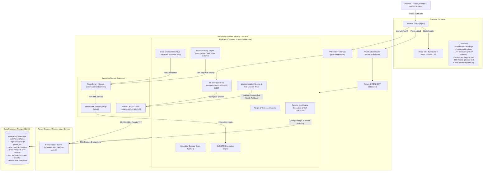
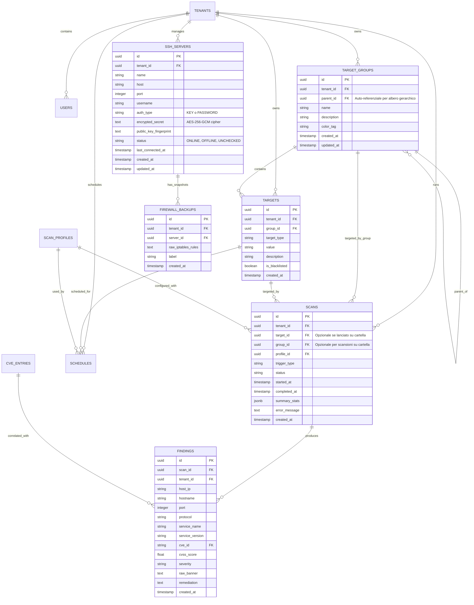

# 2. System Architecture & Technical Specifications

> **Stato:** APPROVATO (Fase 2: System Design - Revisione Milestone 1.1)  
> **Ultimo Aggiornamento:** 2026-10-08  
> **Autore / Ruolo:** TechLead-Engineer-Agent (System Architect)  
> **Documenti Correlati:** [0_REQUIREMENTS_AND_USE_CASES.md](file:///c:/Users/aless/Desktop/Sviluppo/GitHub/NextGen-CyberSecurity/docs/0_REQUIREMENTS_AND_USE_CASES.md) | [1_PROJECT_CONTEXT.md](file:///c:/Users/aless/Desktop/Sviluppo/GitHub/NextGen-CyberSecurity/docs/1_PROJECT_CONTEXT.md)

---

## 1. Diagramma Architetturale di Sistema

La piattaforma adotta un'architettura containerizzata multi-servizio Clean Architecture con disaccoppiamento tra il layer API REST/WebSocket, il motore di ricognizione/scansione Nmap, il gestore di connessioni SSH sicure e firewall, il database relazionale PostgreSQL e la Single Page Application (SPA).



---

## 2. Stack Tecnologico Completo

| Componente | Tecnologia | Versione / Note |
| :--- | :--- | :--- |
| **Backend Language** | **Golang** | `1.22+` (Goroutine, worker pool, type safety) |
| **HTTP & WS Router** | **go-chi/chi/v5** + **gorilla/websocket** | Router HTTP snello con routing WebSocket per terminale interattivo |
| **SSH Client Nativo** | **golang.org/x/crypto/ssh** | Client SSH Go conforme RFC 4251 con supporto chiavi RSA/Ed25519 e password |
| **Crittografia a Riposo** | **Crypto AES-256-GCM** | Cifratura autenticata hardware-accelerata per credenziali SSH |
| **Database & Driver** | **PostgreSQL 16** + **jackc/pgx/v5** | Relational DB con supporto JSONB, indici B-Tree e connection pool |
| **Database Migrations** | **golang-migrate/migrate/v4** | Migrazioni SQL versionate e riproducibili |
| **Network Scanner** | **Nmap** (containerizzato) | `7.94+` con flag minimi di privilegio e parsing streaming |
| **Task Scheduling** | **robfig/cron/v3** | Cron scheduler in-memory con persistenza DB |
| **PDF Reporting** | **jung-kurt/gofpdf** | Generatore nativo PDF (layout Executive e Tecnico) |
| **Frontend Framework** | **React 18** + **TypeScript** | Web UI reattiva modulare |
| **Build Tool Frontend** | **Vite 5+** | Bundling veloce, HMR e build ottimizzata |
| **Terminale Web** | **@xterm/xterm** + **@xterm/addon-fit** | Emulatore terminale ANSI ad alte prestazioni nel browser |
| **UI & Styling** | **Tailwind CSS** + **Lucide Icons** | Design system moderno con dark mode nativo e grafici **Recharts** |
| **Containerization** | **Docker & Docker Compose** | Multi-container: `db`, `backend` (con Nmap), `frontend` (con Nginx) |

---

## 3. Design Pattern e Struttura del Codice (Clean Architecture)

```
backend/
├── cmd/
│   ├── server/             # Entrypoint applicazione principale (main.go)
│   └── cve-sync/           # Utility CLI per sincronizzare il database CVE locale
├── internal/
│   ├── domain/             # Entità di business pure, errori di dominio e interfacce
│   │   ├── tenant.go
│   │   ├── user.go
│   │   ├── target.go       # Include TargetGroup con ParentID per struttura ad albero
│   │   ├── scan.go
│   │   ├── finding.go
│   │   ├── cve.go
│   │   ├── discovery.go    # Modello Device Discovery (IP, MAC, Vendor, Hostname, RTT)
│   │   ├── ssh_server.go   # Modello Server SSH remoto con credenziali cifrate
│   │   └── firewall.go     # Modello Catene e Regole iptables/nftables
│   ├── repository/         # Implementazione persistenza dati PostgreSQL (SQL/pgx)
│   │   ├── postgres/
│   │   │   ├── target_group_repo.go
│   │   │   ├── ssh_server_repo.go
│   │   │   └── firewall_backup_repo.go
│   │   └── migrations/     # File di migrazione .sql versionati
│   ├── service/            # Casi d'uso e logica di business
│   │   ├── auth_service.go
│   │   ├── target_service.go
│   │   ├── scan_service.go
│   │   ├── discovery_service.go   # Engine di discovery veloce con OUI lookup
│   │   ├── cve_service.go
│   │   ├── report_service.go      # Reports Hub con template Executive & Technical
│   │   ├── ssh_service.go         # Gestione sessioni SSH sicure e WebSocket PTY
│   │   └── firewall_service.go    # Parser/Runner iptables con Anti-Lockout Timer
│   ├── scanner/            # Wrapper Nmap, parser XML e profili (Alive-Only)
│   │   ├── nmap_runner.go
│   │   ├── nmap_parser.go
│   │   ├── profiles.go
│   │   └── oui_database.go        # Database IEEE OUI locale per produttori MAC
│   └── delivery/           # HTTP Handlers, WebSocket Handlers e Middleware
│       ├── http/handler/
│       │   ├── target_group_handler.go
│       │   ├── discovery_handler.go
│       │   ├── report_hub_handler.go
│       │   └── ssh_firewall_handler.go
│       └── ws/             # Handler WebSocket per terminale xterm.js
│           └── ssh_terminal_ws.go
└── pkg/
    ├── crypto/             # AES-256-GCM encryption/decryption helper
    ├── auth/               # JWT token & Password Hasher
    └── validator/          # Validatore IP/CIDR/Porte/Firewall rules
```

---

## 4. Schema Database (ERD Esteso)



---

## 5. Contratti API REST & WebSocket (OpenAPI Specifications Summary)

Tutte le API rispondono sotto `/api/v1` (payload JSON `{ "success": true, "data": ..., "error": null }`) e `/ws/v1` per i WebSocket.

### 5.1 Struttura ad Albero Cartelle Target (`/api/v1/target-groups`)
- `GET /api/v1/target-groups` — Restituisce l'albero gerarchico ricorsivo dei gruppi con conteggio target e livello di rischio aggregato.
- `POST /api/v1/target-groups` — Crea un nuovo gruppo/cartella (`{ name, description, parent_id, color_tag }`).
- `PUT /api/v1/target-groups/{id}` — Aggiorna nome, descrizione o sposta cartella (`parent_id`).
- `DELETE /api/v1/target-groups/{id}` — Elimina gruppo (con opzione di riassegnazione o rimozione a cascata).

### 5.2 Network Discovery LAN (Stile Advanced IP Scanner)
- `POST /api/v1/network-discovery/scan` — Avvia un job rapido di ping/ARP sweep su una subnet (es. `{ "subnet": "192.168.1.0/24", "include_common_ports": true }`).
- `GET /api/v1/network-discovery/results` — Restituisce i dispositivi attivi rilevati (IP, MAC, Vendor OUI, Hostname, RTT ms, Porte comuni aperte).
- `POST /api/v1/network-discovery/import-targets` — Importa uno o più dispositivi selezionati come Target ufficiali in una determinata cartella dell'albero.

### 5.3 Hub Centralizzato Reportistica (`/api/v1/reports`)
- `GET /api/v1/reports` — Elenco storico di tutti i report di audit con filtri per data, target, cartella, severità massima e tipo.
- `GET /api/v1/reports/{scan_id}/download?type=pdf&template=executive|technical` — Download diretto del report PDF formattato con branding del tenant nel template prescelto.
- `GET /api/v1/reports/{scan_id}/download?type=csv` — Esportazione tabellare CSV RFC 4180.

### 5.4 Gestione Server SSH Remoti (`/api/v1/ssh/servers`)
- `GET /api/v1/ssh/servers` — Elenco dei server SSH configurati per il tenant.
- `POST /api/v1/ssh/servers` — Registrazione nuovo server (salvataggio cifrato AES-256-GCM delle credenziali).
- `POST /api/v1/ssh/servers/{id}/test-connection` — Test rapido di connettività SSH, verifica latenza e permessi sudo/root.
- `DELETE /api/v1/ssh/servers/{id}` — Eliminazione server censito e chiavi associate.

### 5.5 Gestione Firewall iptables (`/api/v1/ssh/servers/{id}/firewall`)
- `GET /api/v1/ssh/servers/{id}/firewall` — Recupera stato del firewall, default policy delle catene (`INPUT`, `OUTPUT`, `FORWARD`) e lista ordinata delle regole.
- `POST /api/v1/ssh/servers/{id}/firewall/rules` — Aggiunge una nuova regola (azione, protocollo, sorgente, destinazione, porta, commento).
- `DELETE /api/v1/ssh/servers/{id}/firewall/rules/{rule_num}?chain=INPUT` — Rimuove una regola specifica.
- `POST /api/v1/ssh/servers/{id}/firewall/apply-with-safety-timer` — Applica le modifiche attivando il **Safety Rollback Timer** (es. 60s). Salva uno snapshot in `FIREWALL_BACKUPS`.
- `POST /api/v1/ssh/servers/{id}/firewall/confirm` — Conferma la nuova configurazione disattivando il timer di rollback.
- `POST /api/v1/ssh/servers/{id}/firewall/rollback` — Esegue il ripristino manuale immediato all'ultimo snapshot valido (`iptables-restore`).

### 5.6 WebSocket Web Terminal SSH (`/ws/v1/ssh/servers/{id}/terminal`)
- `WS /ws/v1/ssh/servers/{id}/terminal?token={jwt}` — Connessione WebSocket bidirezionale.
  - Client -> Server: payload binari/testuali di input tastiera e messaggi di controllo dimensione finestra (`{ "type": "resize", "cols": 120, "rows": 30 }`).
  - Server -> Client: stream di output PTY grezzo da inviare all'istanza `xterm.js` del browser.
