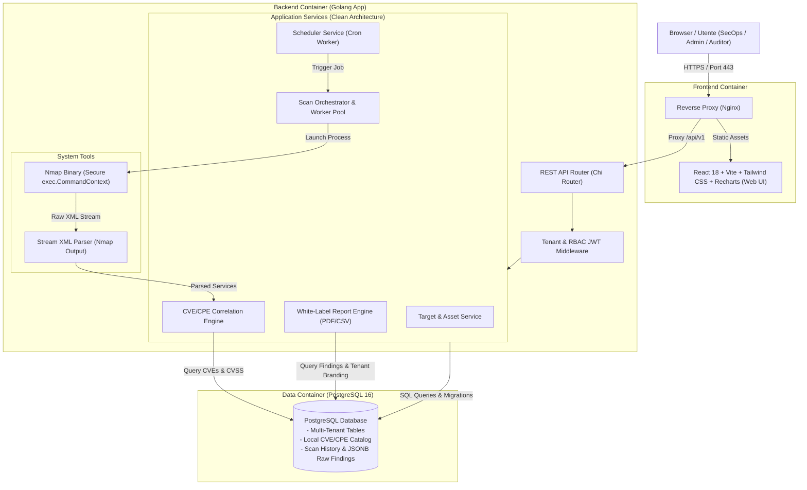
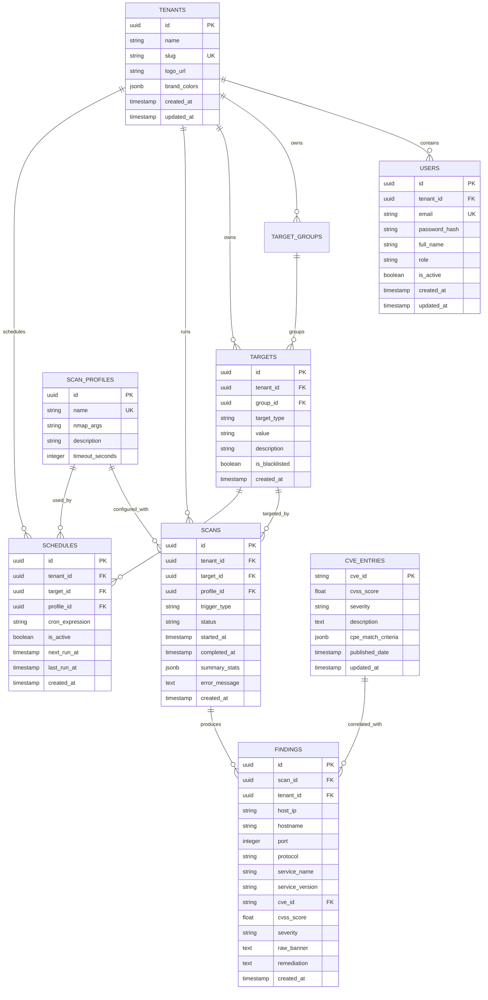

# 2. System Architecture & Technical Specifications

> **Stato:** APPROVATO (Fase 2: System Design)  
> **Ultimo Aggiornamento:** 2026-10-07  
> **Autore / Ruolo:** TechLead-Engineer-Agent (System Architect)  
> **Documenti Correlati:** [0_REQUIREMENTS_AND_USE_CASES.md](file:///c:/Users/aless/Desktop/Sviluppo/GitHub/NextGen-CyberSecurity/docs/0_REQUIREMENTS_AND_USE_CASES.md) | [1_PROJECT_CONTEXT.md](file:///c:/Users/aless/Desktop/Sviluppo/GitHub/NextGen-CyberSecurity/docs/1_PROJECT_CONTEXT.md)

---

## 1. Diagramma Architetturale di Sistema

La piattaforma adotta un'architettura a tre livelli containerizzata con disaccoppiamento tra il layer di gestione API, il motore di esecuzione/orchestrazione Nmap, il database relazionale PostgreSQL e la Single Page Application (SPA).



---

## 2. Stack Tecnologico Completo

| Componente | Tecnologia | Versione / Note |
| :--- | :--- | :--- |
| **Backend Language** | **Golang** | `1.22+` (Alte prestazioni, Goroutine, memory safety) |
| **HTTP Router** | **go-chi/chi/v5** | Router HTTP leggero, 100% compatibile con `net/http` e middleware idiomatici |
| **Database & Driver** | **PostgreSQL 16** + **jackc/pgx/v5** | Driver nativo ad alte prestazioni con connection pooling e supporto JSONB |
| **Database Migrations** | **golang-migrate/migrate/v4** | Migrazioni SQL versionate e riproducibili |
| **Network Scanner** | **Nmap** (containerizzato) | `7.94+` con flag minimi di privilegio e parsing XML nativo |
| **Task Scheduling** | **robfig/cron/v3** | Scheduler cron-like in memoria persistito su DB per i job ricorrenti |
| **PDF Reporting** | **jung-kurt/gofpdf** | Generazione nativa PDF pure-Go con supporto tabelle, grafiche, loghi e palette colori |
| **Frontend Framework** | **React 18** + **TypeScript** | Web UI Single Page Application reattiva |
| **Build Tool Frontend** | **Vite 5+** | Bundling veloce, HMR e build ottimizzata |
| **UI & Styling** | **Tailwind CSS** + **Lucide Icons** | Design system moderno con dark mode nativo e grafici **Recharts** |
| **Containerization** | **Docker & Docker Compose** | Multi-container: `db`, `backend` (con Nmap), `frontend` (con Nginx) |

---

## 3. Design Pattern e Struttura del Codice (Clean Architecture)

Il backend è organizzato secondo i principi della **Clean Architecture / Hexagonal Architecture**:

```
backend/
├── cmd/
│   ├── server/             # Entrypoint applicazione principale (main.go)
│   └── cve-sync/           # Utility CLI per sincronizzare il database CVE locale
├── internal/
│   ├── domain/             # Entità di business pure, errori di dominio e interfacce
│   │   ├── tenant.go
│   │   ├── user.go
│   │   ├── target.go
│   │   ├── scan.go
│   │   ├── finding.go
│   │   └── cve.go
│   ├── repository/         # Implementazione persistenza dati PostgreSQL (SQL/pgx)
│   │   ├── postgres/
│   │   └── migrations/     # File di migrazione .sql
│   ├── service/            # Casi d'uso e logica di business (Orchestratore, Scanner, CVE Matcher)
│   │   ├── auth_service.go
│   │   ├── target_service.go
│   │   ├── scan_service.go
│   │   ├── cve_service.go
│   │   └── report_service.go
│   ├── scanner/            # Wrapper Nmap e parser XML
│   │   ├── nmap_runner.go
│   │   ├── nmap_parser.go
│   │   └── profiles.go
│   └── delivery/           # HTTP Handlers, DTO e Middleware
│       └── http/
│           ├── handler/
│           └── middleware/ # Tenant context, JWT auth, CORS, Error handling
└── pkg/                    # Package riutilizzabili (hasher, jwt, validator)
```

---

## 4. Schema Database (ERD)



---

## 5. Contratti API REST (OpenAPI Specifications Summary)

Tutte le API rispondono sotto il prefisso `/api/v1` e producono payload JSON standard:
`{ "success": true, "data": ..., "error": null }`.

### 5.1 Autenticazione & Profilo Utente
- `POST /api/v1/auth/login` — Autenticazione con email/password, restituisce token JWT e informazioni utente.
- `GET /api/v1/auth/me` — Recupera il profilo dell'utente autenticato e il relativo tenant.
- `POST /api/v1/auth/refresh` — Rinnova il token di accesso tramite refresh token.

### 5.2 Gestione Tenant & Branding (White-Label)
- `GET /api/v1/tenants/current` — Restituisce impostazioni, logo e colori del tenant corrente.
- `PUT /api/v1/tenants/current/branding` — Aggiorna logo (upload base64/file) e palette colori per i report.

### 5.3 Gestione Target & Asset
- `GET /api/v1/targets` — Lista dei target dell'organizzazione (con filtri e paginazione).
- `POST /api/v1/targets` — Creazione nuovo target (IP, CIDR o FQDN con validazione di sintassi e blacklist).
- `DELETE /api/v1/targets/{id}` — Rimozione target.

### 5.4 Profili di Scansione
- `GET /api/v1/scan-profiles` — Lista profili disponibili (`Fast Discovery`, `Standard Service Scan`, `Full Deep Scan`).

### 5.5 Scansioni (Core Execution)
- `POST /api/v1/scans` — Avvio scansione On-Demand (payload: `{ target_id, profile_id }`).
- `GET /api/v1/scans` — Lista storico scansioni con stati e KPI sintetici.
- `GET /api/v1/scans/{id}` — Dettaglio scansione con progresso e statistiche.
- `POST /api/v1/scans/{id}/cancel` — Richiesta di cancellazione immediata (invia segnale di stop al processo Nmap).
- `GET /api/v1/scans/{id}/findings` — Lista di tutte le vulnerabilità e servizi rilevati per la scansione.

### 5.6 Schedulazione Scansioni
- `GET /api/v1/schedules` — Lista job pianificati per il tenant.
- `POST /api/v1/schedules` — Creazione pianificazione ricorrente (target, profilo, espressione cron).
- `PUT /api/v1/schedules/{id}/toggle` — Attivazione/disattivazione pianificazione.

### 5.7 White-Label Reporting
- `GET /api/v1/scans/{id}/reports/pdf` — Genera e scarica il report PDF con template white-label del tenant.
- `GET /api/v1/scans/{id}/reports/csv` — Scarica l'export tabellare CSV dei findings.

### 5.8 Database CVE (Admin)
- `GET /api/v1/cve/stats` — Numero di CVE indicizzate e timestamp dell'ultimo aggiornamento.
- `POST /api/v1/cve/sync` — Avvia un job asincrono di sincronizzazione del catalogo CVE locale.

