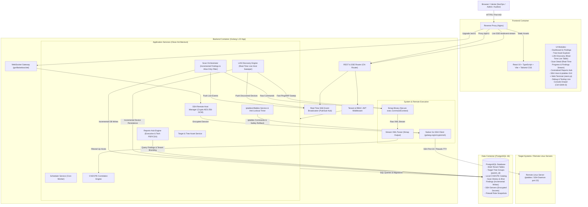

# 2. System Architecture & Technical Specifications

> **Stato:** APPROVATO (Fase 2: System Design - Struttura Autonoma v6.0)  
> **Ultimo Aggiornamento:** 2026-10-09  
> **Autore / Ruolo:** TechLead-Engineer-Agent (System Architect)  
> **Documenti Correlati:** [0_REQUIREMENTS.md](file:///c:/Users/aless/Desktop/Sviluppo/GitHub/NextGen-CyberSecurity/docs/0_REQUIREMENTS.md) | [1_PROJECT_CONTEXT.md](file:///c:/Users/aless/Desktop/Sviluppo/GitHub/NextGen-CyberSecurity/docs/1_PROJECT_CONTEXT.md)

---

## 1. Diagramma Architetturale di Sistema

La piattaforma adotta un'architettura containerizzata multi-servizio Clean Architecture con disaccoppiamento tra il layer API REST/SSE/WebSocket, il motore di ricognizione/scansione Nmap, il gestore di connessioni SSH sicure e firewall, il database relazionale PostgreSQL e la Single Page Application (SPA).



---

## 2. Stack Tecnologico Completo

| Componente | Tecnologia | Versione / Note |
| :--- | :--- | :--- |
| **Backend Language** | **Golang** | `1.22+` (Goroutine, worker pool, type safety) |
| **HTTP Router & SSE** | **go-chi/chi/v5** + `http.Flusher` | Router HTTP snello con supporto nativo Server-Sent Events (`text/event-stream`) |
| **WebSocket Gateway** | **gorilla/websocket** | Gateway WebSocket dedicato per il terminale remoto interattivo PTY |
| **Event Broadcaster** | **In-Memory Pub/Sub Hub Go** | Canali Go bufferizzati con multiplexing per tenant/sessione e safety timeout |
| **SSH Client Nativo** | **golang.org/x/crypto/ssh** | Client SSH Go conforme RFC 4251 con supporto chiavi RSA/Ed25519 e password |
| **Crittografia a Riposo** | **Crypto AES-256-GCM** | Cifratura autenticata hardware-accelerata per credenziali SSH |
| **Database & Driver** | **PostgreSQL 16** + **jackc/pgx/v5** | Relational DB con supporto JSONB, indici B-Tree e salvataggio incrementale findings |
| **Database Migrations** | **golang-migrate/migrate/v4** | Migrazioni SQL versionate e riproducibili |
| **Network Scanner** | **Nmap** (containerizzato) | `7.94+` con flag minimi di privilegio e parsing streaming |
| **Task Scheduling** | **robfig/cron/v3** | Cron scheduler in-memory con persistenza DB |
| **PDF Reporting** | **jung-kurt/gofpdf** | Generatore nativo PDF (layout Executive e Tecnico) |
| **Frontend Framework** | **React 18** + **TypeScript** | Web UI reattiva modulare |
| **Build Tool Frontend** | **Vite 5+** | Bundling veloce, HMR e build ottimizzata |
| **Live Stream Client** | **Native EventSource / Fetch SSE** | Connessione stream persistente con riconnessione automatica e parsing eventi |
| **Terminale Web** | **@xterm/xterm** + **@xterm/addon-fit** | Emulatore terminale ANSI ad alte prestazioni nel browser |
| **Debug & Diagnostics** | **Custom Ring-Buffer Logger + Interceptors** | Cattura trasparente chiamate Axios, eventi SSE, WebSocket ed eccezioni JS con export Markdown |
| **UI & Styling** | **Tailwind CSS** + **Lucide Icons** | Design system moderno con dark mode nativo e grafici **Recharts** |
| **Containerization** | **Docker & Docker Compose** | Multi-container: `postgres`, `backend` (con Nmap), `frontend` (con Nginx) |

---

## 3. Design Pattern e Struttura del Codice (Clean Architecture)

```
backend/
├── cmd/
│   ├── server/             # Entrypoint applicazione principale (main.go)
│   └── cve-sync/           # Utility CLI per sincronizzare il database CVE locale
├── internal/
│   ├── domain/             # Entità di business pure, errori di dominio e interfacce
│   ├── repository/         # Implementazione persistenza dati PostgreSQL (SQL/pgx)
│   │   ├── postgres/       # Repository concreti per entità
│   │   └── migrations/     # File di migrazione .sql versionati
│   ├── service/            # Casi d'uso e logica di business
│   ├── scanner/            # Wrapper Nmap, parser XML e profili (Alive-Only)
│   └── delivery/           # Handlers HTTP REST, SSE, WebSocket e Middleware
└── pkg/
    ├── crypto/             # AES-256-GCM encryption/decryption helper
    ├── auth/               # JWT token & Password Hasher
    ├── report/             # Generatori PDF e CSV
    └── validator/          # Validatore IP/CIDR/Porte/Firewall rules
```

---

## 4. Schema Database (ERD Esteso)


---

## 5. Documentazione Dettagliata per Dominio

Per garantire modularità ed efficienza di contesto, i dettagli tecnici e i contratti specifici sono frammentati nei file di dominio:

1. **[Scanning & LAN Network Discovery](file:///c:/Users/aless/Desktop/Sviluppo/GitHub/NextGen-CyberSecurity/docs/domains/scanning_and_discovery.md)**: 13 profili specialistici (6 macro-aree), configuratore professionale con Live Command Preview, validazione sicura argomenti, filtro host spenti (Alive-Only), LAN Discovery con OUI database, scansioni per azienda (`POST /api/v1/target-groups/{id}/scan`) e stream SSE in tempo reale.
2. **[Remote SSH & iptables Firewall Manager](file:///c:/Users/aless/Desktop/Sviluppo/GitHub/NextGen-CyberSecurity/docs/domains/ssh_and_firewall.md)**: Gestione credenziali e cifratura AES-256-GCM, Anti-Lockout Safety Timer, ispezione e modifica regole iptables, WebSocket Web Terminal SSH PTY.
3. **[Asset Tree Management & Centralized Reports Hub](file:///c:/Users/aless/Desktop/Sviluppo/GitHub/NextGen-CyberSecurity/docs/domains/reporting_and_assets.md)**: Workstation Multi-Company Workflow, albero gerarchico asset (`TargetGroup`), dossier consolidati per azienda (`GET /api/v1/reports/company/{groupId}/download`), algoritmo Posture Score normalizzato e perfezionamento tipografico A4 (Executive 2 pagine dense, technical continuous flow fino a 270mm, wrapping multiriga fluido).
4. **[Debug & Testing Live Console Drawer](file:///c:/Users/aless/Desktop/Sviluppo/GitHub/NextGen-CyberSecurity/docs/domains/debug_console.md)**: In-Memory Ring Buffer (500 log), intercettori Axios/SSE/WS/JS, sanificazione credenziali `[REDACTED]` ed esportatore Markdown preformattato per AI.
5. **[Attack Path Mapping & Threat Chaining](file:///c:/Users/aless/Desktop/Sviluppo/GitHub/NextGen-CyberSecurity/docs/domains/attack_path.md)**: Analisi topologica a grafo, calcolo del Cumulative Path Risk Score, rilevamento catene di compromissione, individuazione algoritmica dei chokepoint e Visual Graph Explorer SVG interattivo con controlli zoom/pan e filtri CVSS.
6. **[Vulnerability Intelligence & CVE Correlation](file:///c:/Users/aless/Desktop/Sviluppo/GitHub/NextGen-CyberSecurity/docs/domains/vulnerability_intelligence.md)**: Catalogo locale offline-ready, client REST NIST NVD API 2.0 (timeout 4s), auto-caching PostgreSQL su `cve_entries`, correlazione script NSE (`--script=vuln`, `--script=vulners`) ed endpoint `/api/v1/cve/stats` e `/api/v1/cve/sync`.

---

## 6. Contratti API REST, SSE e WebSocket (Riepilogo)

Tutte le API rispondono sotto `/api/v1` con payload standard `{ "success": true, "data": ..., "error": null }` e autenticazione Bearer JWT:

- `POST /api/v1/auth/login`, `POST /api/v1/auth/refresh`, `GET /api/v1/auth/me`, `POST /api/v1/auth/stream-ticket` (Ticket Monouso TTL 30s)
- `GET /api/v1/tenants/current`, `PUT /api/v1/tenants/current/branding`
- `GET`, `POST`, `DELETE /api/v1/targets`, `GET /api/v1/targets/{id}`
- `GET`, `POST`, `PUT`, `DELETE /api/v1/target-groups`, `GET /api/v1/target-groups/{id}`, `POST /api/v1/target-groups/{id}/scan`
- `GET`, `POST`, `DELETE /api/v1/scan-profiles`
- `POST /api/v1/network-discovery/scan`, `GET /api/v1/network-discovery/results`, `POST /api/v1/network-discovery/import-targets`
- `GET /api/v1/network-discovery/stream?session_id={id}&ticket={ticket}` (SSE con ticket monouso, fallback `?token=`)
- `POST /api/v1/scans`, `GET /api/v1/scans`, `GET /api/v1/scans/{id}`, `POST /api/v1/scans/{id}/cancel`
- `GET /api/v1/scans/{id}/findings`, `GET /api/v1/scans/{id}/stream?ticket={ticket}` (SSE con ticket monouso, fallback `?token=`)
- `GET /api/v1/reports`, `GET /api/v1/reports/{id}/download` (PDF/CSV), `GET /api/v1/reports/company/{groupId}/download` (PDF/CSV)
- `GET /api/v1/scans/{id}/reports/pdf`, `GET /api/v1/scans/{id}/reports/csv`
- `GET /api/v1/schedules`, `GET /api/v1/schedules/{id}`, `POST /api/v1/schedules`, `PUT /api/v1/schedules/{id}/toggle`, `DELETE /api/v1/schedules/{id}`
- `GET /api/v1/cve/stats`, `POST /api/v1/cve/sync`
- `GET /api/v1/attack-paths/graph`, `GET /api/v1/attack-paths/chokepoints`
- `GET`, `POST`, `PUT`, `DELETE /api/v1/ssh/servers`, `GET /api/v1/ssh/servers/{id}`, `POST /api/v1/ssh/servers/{id}/test-connection`
- `GET /api/v1/ssh/servers/{id}/firewall`, `POST /api/v1/ssh/servers/{id}/firewall/rules`, `DELETE /api/v1/ssh/servers/{id}/firewall/rules/{line}`
- `POST /api/v1/ssh/servers/{id}/firewall/apply`, `POST /api/v1/ssh/servers/{id}/firewall/confirm`, `POST /api/v1/ssh/servers/{id}/firewall/rollback`
- `GET /ws/v1/ssh/servers/{id}/terminal?ticket={ticket}` (WebSocket PTY con ticket monouso, fallback `?token=`)

---

## 7. Architecture Decision Records (ADR)

- **ADR-01 (Modularizzazione Documentazione per Domini):** Scomposizione dei dettagli architetturali in `docs/domains/` mantenendo `2_ARCHITECTURE.md` snello per contratti globali ed ERD.
- **ADR-02 (Preservazione Storica Legacy):** Archiviazione storica dei documenti preesistenti in `docs/_legacy/` con tracciamento mapping.
- **ADR-03 (Branching Strategy):** Utilizzo di branch tematici dedicati per feature (`feat/`) e manutenzione (`chore/agent-onboarding`).
- **ADR-04 (Stream-Ticket Monouso & Hardening Perimetro Scansioni SEC-P0):**
  - **Contesto:** I token JWT a lungo termine inviati in query string (`?token=...`) per SSE e WebSocket venivano esposti nei log proxy/Nginx e nella cronologia browser. Inoltre, l'esecuzione di Nmap necessitava di barriere perimetrali contro l'iniezione di flag o target interni.
  - **Decisione:**
    1. Implementato `StreamTicketStore` in memoria, thread-safe con TTL 30s e auto-invalidation atomica al primo utilizzo. Endpoint `POST /api/v1/auth/stream-ticket` protetto da Bearer header.
    2. Separatore POSIX `--` anteposto sistematicamente al target nell'invocazione di Nmap in `BuildSafeArguments`.
    3. Deny-list preventiva in `CheckTargetScope` contro loopback, link-local, bridge Docker e host della piattaforma, con risoluzione DNS anti-rebinding.
    4. Watchdog di rollback firewall remoto via `nohup` distaccato per garanzia di ripristino anche in caso di caduta connessione SSH.
  - **Conseguenze:** Eliminazione del rischio di cred leakage nei log; sicurezza perimetrale dello scanner rafforzata; piena retrocompatibilità garantita.

