# 🛡️ NextGen CyberSecurity Platform — Guida Completa alle Funzionalità
### Manuale Operativo e Mappa Funzionale: Frontend, Backend e Guida ad ogni Singolo Tasto

> **Destinatari:** Product Owner, Utenti Amministratori, Referenti di Sicurezza e chiunque desideri comprendere il funzionamento completo della piattaforma, anche senza competenze tecniche pregresse.  
> **Stato del Progetto:** Tutte le funzionalità descritte in questa guida sono **realmente implementate, collaudate e operative** all'interno dell'applicazione. Nessuna funzione ipotetica o futura è inclusa.

---

## 📖 Indice dei Contenuti
1. [Cos'è NextGen CyberSecurity Platform (In Parole Semplici)](#1-cosè-nextgen-cybersecurity-platform-in-parole-semplici)
2. [Come Dialogano lo Schermo (Frontend) e il Cervello (Backend)](#2-come-dialogano-lo-schermo-frontend-e-il-cervello-backend)
3. [La Struttura Generale: Menu di Navigazione e Selettore Aziendale Globale](#3-la-struttura-generale-menu-di-navigazione-e-selettore-aziendale-globale)
4. [Feature 1 · Accesso alla Piattaforma (Login)](#feature-1--accesso-alla-piattaforma-login)
5. [Feature 2 · Pannello di Controllo Generale (Dashboard)](#feature-2--pannello-di-controllo-generale-dashboard)
6. [Feature 3 · Gestione delle Aziende Clienti (Companies)](#feature-3--gestione-delle-aziende-clienti-companies)
7. [Feature 4 · Bersagli e Mappatura dei Reparti (Targets & Asset Tree)](#feature-4--bersagli-e-mappatura-dei-reparti-targets--asset-tree)
8. [Feature 5 · Ricognizione Automatica della Rete Locale (LAN Network Discovery)](#feature-5--ricognizione-automatica-della-rete-locale-lan-network-discovery)
9. [Feature 6 · Centro Scansioni di Sicurezza (Scans & Profili di Analisi)](#feature-6--centro-scansioni-di-sicurezza-scans--profili-di-analisi)
10. [Feature 7 · Dettaglio della Scansione e Confronto Storico (Scan Detail & Scan Diff)](#feature-7--dettaglio-della-scansione-e-confronto-storico-scan-detail--scan-diff)
11. [Feature 8 · Archivio delle Vulnerabilità Trovate (Findings & CVE Intelligence)](#feature-8--archivio-delle-vulnerabilità-trovate-findings--cve-intelligence)
12. [Feature 9 · Mappa Visuale dei Vettori d'Attacco e Punti Critici (Attack Path & Chokepoints)](#feature-9--mappa-visuale-dei-vettori-dattacco-e-punti-critici-attack-path--chokepoints)
13. [Feature 10 · Controllo dei Server Remoti e Protezione Firewall (SSH & iptables GUI)](#feature-10--controllo-dei-server-remoti-e-protezione-firewall-ssh--iptables-gui)
14. [Feature 11 · Centro Stampa Report Professionali (Reports Hub)](#feature-11--centro-stampa-report-professionali-reports-hub)
15. [Feature 12 · Personalizzazione del Marchio e Impostazioni (Settings)](#feature-12--personalizzazione-del-marchio-e-impostazioni-settings)
16. [Feature 13 · Console di Diagnostica in Tempo Reale (Live Debug Console `>_`)](#feature-13--console-di-diagnostica-in-tempo-reale-live-debug-console-)
17. [Matrice di Sintesi Rapida di Ogni Tasto](#17-matrice-di-sintesi-rapida-di-ogni-tasto)

---

## 1. Cos'è NextGen CyberSecurity Platform (In Parole Semplici)

Immagina di essere il custode di un grande palazzo o di un intero isolato aziendale:
- Ci sono decine di stanze (**i reparti aziendali**).
- In ogni stanza ci sono porte, finestre, computer, stampanti e casseforti (**i dispositivi e gli indirizzi IP**).
- Alcune finestre potrebbero essere rimaste aperte per errore, oppure alcune serrature potrebbero essere vecchie e facili da scassinare per i ladri (**le vulnerabilità informatiche e le porte aperte**).

**NextGen CyberSecurity Platform** è la tua "centrale operativa di sicurezza":
1. **Trova tutto ciò che è collegato alla rete** (anche se qualcuno ha attaccato un dispositivo senza dirtelo).
2. **Fa il giro di controllo (la scansione)** per bussare a tutte le porte e verificare quali serrature sono deboli o difettose.
3. **Calcola come un ladro (hacker) potrebbe muoversi**: ti dice se, entrando da una stampante poco protetta, potrebbe arrivare fino alla cassaforte centrale dove ci sono i dati segreti.
4. **Ti suggerisce dove intervenire per fermarlo subito** con il minimo sforzo (chiudendo il "passaggio obbligato" o chokepoint).
5. **Ti permette di collegarti ai server per blindarli** con un firewall, senza farti rischiare di rimanere chiuso fuori per errore.
6. **Stampa bellissimi documenti ufficiali (in PDF e CSV)** con il logo e i colori della tua azienda, pronti da consegnare al titolare o ai tecnici.

---

## 2. Come Dialogano lo Schermo (Frontend) e il Cervello (Backend)

L'applicazione è composta da due parti che collaborano continuamente in armonia:

```
[ TU ]  ── clicca un tasto ──>  [ FRONTEND (Lo Schermo) ]
                                      │
                                      ▼  Invia richiesta sicura (API / Web)
                                [ BACKEND (Il Motore in Go) ]
                                      │
                         ┌────────────┴────────────┐
                         ▼                         ▼
                  [ DATABASE (PostgreSQL) ]    [ SCANNER DI RETE (Nmap) ]
                  (Salva e custodisce i dati)  (Interroga i computer bersaglio)
```

1. **Il Frontend (Lo Schermo Visibile):** è l'interfaccia grafica moderna e scura (dark mode) che usi nel browser internet. È pensata per essere reattiva: ogni volta che premi un pulsante, ti mostra immediatamente finestre, grafici colorati o conferme visive.
2. **Il Backend (Il Motore Invisibile):** è il server che gira silenziosamente dietro le quinte. Quando premi un tasto, il Frontend invia un messaggio cifrato al Backend. Il Backend controlla che tu abbia i permessi, esegue il comando richiesto (ad esempio fa partire lo scanner di rete o aggiorna il database) e rimanda la risposta al tuo schermo.
3. **Il Database (L'Archivio Sicuro):** è la cassaforte digitale dove vengono custoditi i nomi delle aziende, i reparti, la storia di tutte le scansioni fatte e l'elenco delle vulnerabilità trovate.
4. **La Comunicazione dal Vivo (Eventi in Tempo Reale):** mentre una scansione è in corso, non devi aggiornare la pagina premendo F5: il Backend invia continuamente aggiornamenti al Frontend come se fosse una trasmissione radio in diretta.

---

## 3. La Struttura Generale: Menu di Navigazione e Selettore Aziendale Globale

Quando usi l'applicazione, sulla sinistra dello schermo c'è una **barra laterale (Sidebar)** sempre visibile che ti permette di spostarti tra le varie sezioni.

### Il Selettore Aziendale Globale ("Scope")
In cima alla barra laterale trovi un elemento fondamentale: **il Selettore dell'Azienda**.
- **Cosa fa a schermo:** Ti permette con un clic di scegliere su quale azienda cliente vuoi concentrarti in quel momento (ad esempio *"Azienda Alpha"* oppure *"Tutte le Aziende"*).
- **Cosa succede dietro le quinte nel Backend:** Appena scegli un'azienda, l'applicazione memorizza la tua preferenza e istantaneamente "filtra" tutte le pagine. Quando vai nella Dashboard, nei Bersagli, nelle Scansioni o nei Report, vedrai solo ed esclusivamente i dati appartenenti a quell'azienda, evitando qualsiasi confusione o scambio di dati tra clienti diversi.

---

## Feature 1 · Accesso alla Piattaforma (Login)

Prima di poter vedere o toccare qualsiasi cosa, la piattaforma richiede che tu ti faccia riconoscere con le tue credenziali autorizzate.

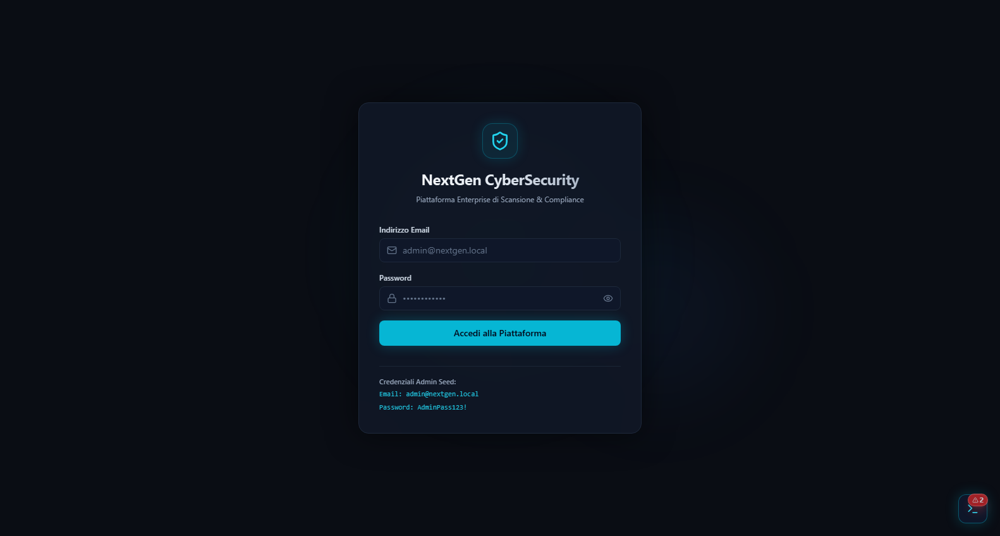

### Cosa vedi sullo schermo
Una schermata pulita e protetta con il logo della piattaforma, un campo per la tua email, un campo per la tua password, un pulsante di accesso e un'icona a forma di occhio per controllare cosa stai scrivendo.

### Descrizione dei Tasti e Controlli
| Elemento a Schermo | Cosa Fa sul Frontend (Schermo) | Cosa Fa nel Backend (Dietro le Quinte) |
| :--- | :--- | :--- |
| **Campo Email** | Ti consente di digitare il tuo indirizzo email di lavoro (es. `admin@nextgen.local`). Verifica subito che il formato dell'email sia corretto. | Nessuna azione immediata: attende che tu prema il tasto di invio. |
| **Campo Password** | Ti consente di digitare la tua parola d'ordine segreta. I caratteri sono nascosti da pallini per evitare che chi ti sta vicino possa leggerli. | Nessuna azione immediata fino al clic di accesso. |
| **Icona Occhiolino** | Cliccandola, rende temporaneamente visibili le lettere della password per permetterti di correggere eventuali errori di battitura. | Azione puramente visiva sul browser: la password non viene inviata a nessuno. |
| **Pulsante "Accedi" / "Login"** | Mostra un'animazione di caricamento e blocca momentaneamente il modulo per evitare doppi clic accidentali. Se le credenziali sono corrette, ti porta direttamente alla Dashboard. In caso di errore, mostra un chiaro avviso rosso. | Invia una richiesta di autenticazione protetta. Il Backend cerca l'utente nel database PostgreSQL, prende la password e la confronta utilizzando un algoritmo crittografico sicuro (`Bcrypt`). Se coincide, genera un pass digitale cifrato (chiamato *token JWT*) che identificherà tutte le tue azioni successive per 60 minuti. |

---

## Feature 2 · Pannello di Controllo Generale (Dashboard)

La Dashboard è il cuore informativo: appena entri ti dà un colpo d'occhio immediato sulla salute e sulla sicurezza di tutta la tua infrastruttura.

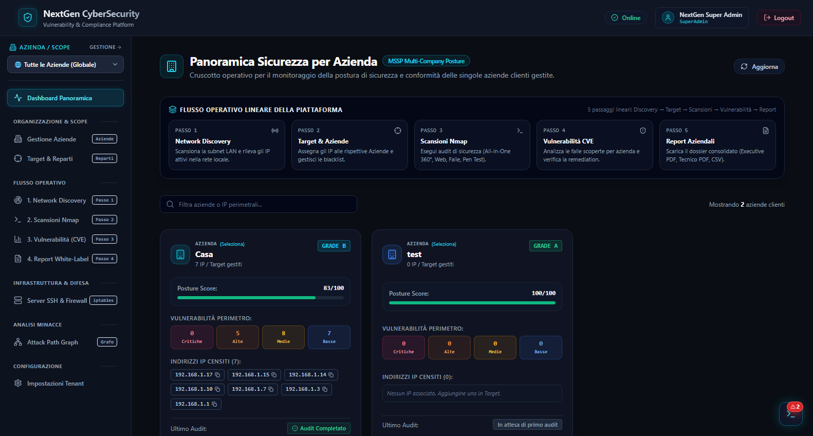

### Cosa vedi sullo schermo
- **Card con Grandi Numeri (Indicatori Chiave KPI):** 
  - *Postura di Sicurezza Globale:* un voto da 0 a 100 con un colore intuitivo (verde se la rete è protetta, arancione se ci sono attenzioni, rosso se ci sono pericoli imminenti).
  - *Host Totali:* il numero di computer e apparati censiti.
  - *Scansioni Attive / Concluse:* il conteggio dei test svolti.
  - *Vulnerabilità Critiche:* il numero esatto di pericoli gravi che richiedono attenzione urgente.
- **Grafico a Ciambella / Barre:** mostra la proporzione delle vulnerabilità suddivise per gravità (Critiche, Alte, Medie, Basse).
- **Trend Temporale:** un grafico a linee che mostra se la tua sicurezza sta migliorando o peggiorando nel corso dei mesi.
- **Banner dello Scope Attivo:** in alto ti ricorda sempre se stai guardando i dati di un'azienda specifica o una panoramica globale.

### Descrizione dei Tasti e Controlli
| Elemento a Schermo | Cosa Fa sul Frontend (Schermo) | Cosa Fa nel Backend (Dietro le Quinte) |
| :--- | :--- | :--- |
| **Selettore Azienda (in alto o in sidebar)** | Cambia istantaneamente i numeri e i grafici della dashboard per mostrare i dati dell'azienda selezionata. | Il Backend esegue una serie di query SQL veloci filtrate per l'identificativo dell'azienda e ricalcola all'istante le statistiche e il voto di sicurezza (*Posture Score normalizzato*). |
| **Card Cliccabili dei KPI** | Cliccando ad esempio sulla card "Vulnerabilità Critiche", vieni trasportato direttamente alla pagina delle Vulnerabilità con il filtro "Critiche" già attivo. | Il browser cambia percorso applicativo (`/findings?severity=CRITICAL`) e chiede al Backend solo l'elenco corrispondente. |
| **Grafico Interattivo della Severità** | Passando il mouse sopra le fette del grafico, compaiono riquadri esplicativi con le percentuali esatte e il numero di vulnerabilità. | Elaborazione grafica immediata nel browser senza richiedere nuovi dati al server. |

---

## Feature 3 · Gestione delle Aziende Clienti (Companies)

Questa sezione (`/companies`) è dedicata alla gestione organizzativa multi-cliente (modalità MSSP). Consente di registrare tutte le aziende che segui e visualizzare la scheda di salute di ciascuna.

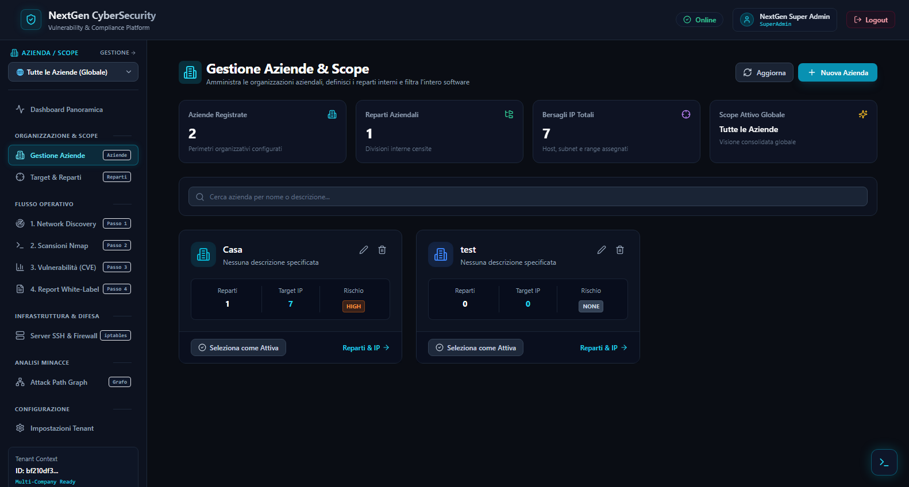

### Cosa vedi sullo schermo
Una griglia di schede (card) eleganti, una per ogni azienda censita. Ogni scheda ti mostra:
- Il nome e la descrizione dell'azienda.
- Il colore distintivo assegnato.
- Quanti reparti interni possiede (es. Amministrazione, Server Farm, Magazzino).
- Quanti indirizzi IP sono stati registrati per quell'azienda.
- La postura di sicurezza specifica (voto da 0 a 100).
- Il livello di rischio complessivo.

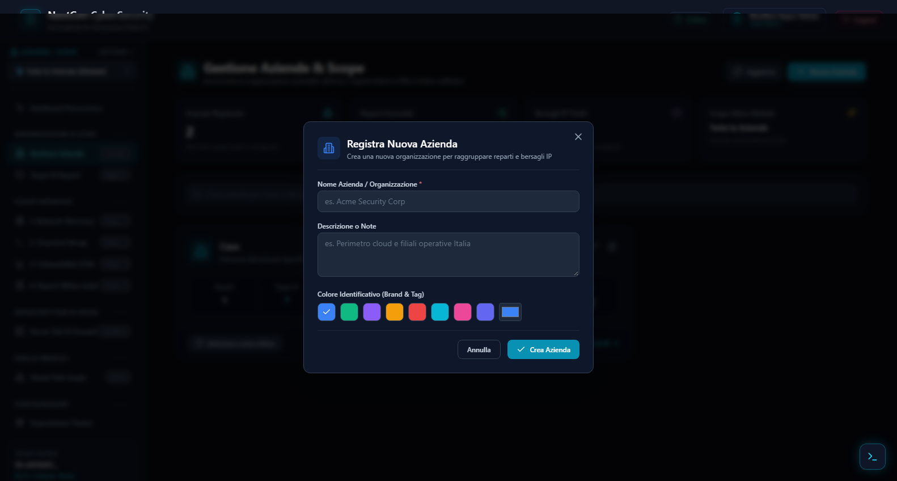

### Descrizione dei Tasti e Controlli
| Elemento a Schermo | Cosa Fa sul Frontend (Schermo) | Cosa Fa nel Backend (Dietro le Quinte) |
| :--- | :--- | :--- |
| **Pulsante "+ Nuova Azienda"** | Apre una finestra sovrapposta (modale) pulita con i campi per inserire Ragione Sociale, Descrizione e scegliere una tinta colore dalla tavolozza. | Nessuna chiamata finché non premi Salva: prepara il modulo nel browser. |
| **Selettore Colore Tag (nella Modale)** | Permette di scegliere un colore vivace (es. blu, verde smeraldo, viola) per distinguere a colpo d'occhio l'azienda in tutte le tabelle. | Memorizza il codice colore esadecimale (es. `#06b6d4`) nel pacchetto da salvare. |
| **Pulsante "Salva Azienda" (nella Modale)** | Valida che il nome non sia vuoto, chiude la finestra e aggiunge subito la nuova card alla lista. | Invia una richiesta `POST /api/v1/target-groups` creando un nuovo gruppo principale nel database (con `parent_id = NULL` che indica che si tratta di un'azienda radice). |
| **Pulsante "Imposta come Scope Attivo" (icona mirino)** | Evidenzia la card come attiva e imposta il selettore globale della piattaforma su questa specifica azienda. | Salva la selezione nella memoria locale del browser (`localStorage`) e ricalcola ricorsivamente la lista di tutti i reparti e IP appartenenti a quell'azienda. |
| **Pulsante "Modifica" (icona matita)** | Riapre la finestra con i dati dell'azienda già compilati per consentirti di aggiornare nome, note o colore. | Invia una richiesta `PUT /api/v1/target-groups/{id}` che aggiorna il record nel database PostgreSQL. |
| **Pulsante "Elimina" (icona cestino)** | Mostra una richiesta di conferma per evitare cancellazioni involontarie. | Invia `DELETE /api/v1/target-groups/{id}`. Il Backend controlla che non ci siano scansioni in corso collegate e rimuove l'azienda in sicurezza. |

---

## Feature 4 · Bersagli e Mappatura dei Reparti (Targets & Asset Tree)

Nella sezione `/targets` puoi disegnare la mappa gerarchica interna dell'azienda selezionata. Non ci si limita a inserire elenchi piatti di numeri IP, ma si possono organizzare i dispositivi all'interno di una struttura logica a cartelle e reparti.


### Cosa vedi sullo schermo
- **A sinistra, l'Albero dei Reparti (TreeExplorer):** un albero interattivo con cartelle espandibili (ad esempio: *Sede Centrale* ➔ *Ufficio Contabilità* oppure *Sede Secondaria* ➔ *Laboratorio Ricerca*).
- **A destra, la Tabella dei Bersagli:** la lista degli indirizzi IP contenuti nel reparto che hai cliccato, con tipo (IP singolo o rete CIDR), note e data di creazione.
- **Badge dell'Azienda Attiva:** in cima alla pagina è sempre chiaro a quale azienda appartengono i reparti mostrati.

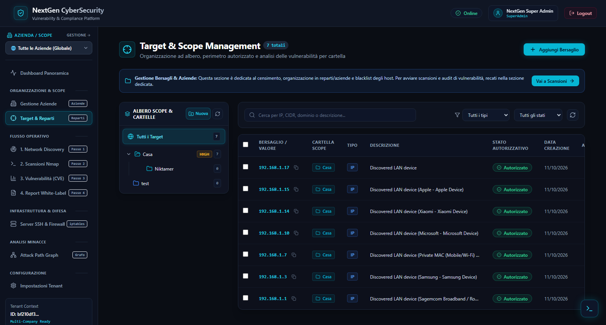

### Descrizione dei Tasti e Controlli
| Elemento a Schermo | Cosa Fa sul Frontend (Schermo) | Cosa Fa nel Backend (Dietro le Quinte) |
| :--- | :--- | :--- |
| **Pulsante "+ Aggiungi Reparto"** | Apre una finestra per dare un nome al nuovo reparto e associarlo all'azienda o a un reparto genitore. | Invia `POST /api/v1/target-groups` impostando il campo `parent_id` per creare la relazione padre-figlio nella gerarchia del database. |
| **Pulsante "+ Aggiungi Target"** | Apre la finestra di inserimento bersaglio, chiedendo l'indirizzo (es. `192.168.1.50` o `10.0.0.0/24`) e una descrizione. | Il Backend esegue una **rigida validazione di sicurezza**: verifica la sintassi dell'indirizzo e controlla con una lista di divieti (*deny-list*) che tu non stia cercando per sbaglio di colpire macchine protette interne o indirizzi speciali di sistema (*anti-rebinding DNS*). Se valido, lo salva nella tabella `targets`. |
| **Pulsante "Avvia Scansione Reparto" (icona Play accanto al reparto)** | Ti permette di lanciare direttamente un controllo di sicurezza su tutti i computer di quel reparto in un solo clic. | Chiama `POST /api/v1/target-groups/{id}/scan`, raccoglie tutti gli indirizzi IP dei computer presenti in quella cartella e avvia la scansione collettiva. |
| **Pulsante "Elimina Target" (icona cestino)** | Rimuove il bersaglio selezionato dalla tabella dopo tua conferma. | Invia `DELETE /api/v1/targets/{id}` rimuovendo l'associazione nel database senza intaccare i dati storici delle scansioni passate. |

---

## Feature 5 · Ricognizione Automatica della Rete Locale (LAN Network Discovery)

La pagina `/network-discovery` funziona esattamente come un **radar sonar**: se arrivi in un ufficio nuovo e non sai quali computer, stampanti, telecamere o server siano accesi, questa funzione li individua automaticamente in pochi secondi.

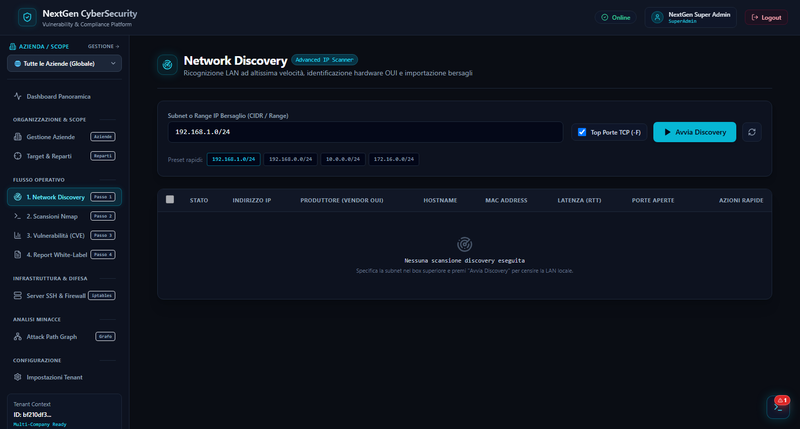

### Cosa vedi sullo schermo
- Un campo di inserimento per specificare la porzione di rete da perlustrare (ad esempio `192.168.1.0/24`).
- Un grande pulsante di avvio radar.
- Una barra di avanzamento e un contatore che ti dice quanti dispositivi sono stati individuati man mano che rispondono.
- Una tabella dei risultati con colonne ricche di informazioni: Indirizzo IP, Indirizzo Fisico (MAC Address), Produttore della scheda (es. Apple, Dell, HP, Cisco), Latenza (tempo di risposta in millisecondi) e prime porte aperte scoperte.
- Caselle di selezione per scegliere quali dispositivi importare.

### Descrizione dei Tasti e Controlli
| Elemento a Schermo | Cosa Fa sul Frontend (Schermo) | Cosa Fa nel Backend (Dietro le Quinte) |
| :--- | :--- | :--- |
| **Campo "Subnet da Scansionare"** | Ti permette di digitare l'intervallo di rete da esplorare. Suggerisce formati tipici come `/24`. | Valida che la maschera di rete non sia eccessivamente grande (evitando di bloccare la rete con richieste spropositate). |
| **Pulsante "Avvia Discovery Subnet"** | Avvia l'esplorazione: disabilita temporaneamente il pulsante per evitare doppie partenze, attiva l'indicatore di scansione in corso e azzera la tabella pronto a riempirla dal vivo. | Il Backend lancia il motore di ricognizione ultra-veloce Nmap (eseguendo un *Ping/ARP sweep* non invasivo). Man mano che un host risponde, consulta un database interno di produttori hardware (*OUI database*) per tradurre il codice della scheda di rete nel nome dell'azienda produttrice (es. "Cisco Systems"). Spedisce ogni dispositivo trovato al browser via *Server-Sent Events (SSE)* in tempo reale. |
| **Caselle di Selezione (Checkbox)** | Ti consentono di selezionare singoli dispositivi o di selezionarli tutti con la casella generale in cima alla tabella. | Gestione dello stato di selezione puramente visiva nel browser. |
| **Pulsante "Importa nei Target Selezionati"** | Trasforma istantaneamente i dispositivi che hai spuntato in bersagli ufficiali dell'azienda, senza costringerti a riscrivere a mano decine di indirizzi IP. | Invia `POST /api/v1/network-discovery/import-targets`. Il Backend prende la lista dei dispositivi selezionati e li inserisce direttamente nella tabella `targets` collegandoli all'azienda attiva. |

---

## Feature 6 · Centro Scansioni di Sicurezza (Scans & Profili di Analisi)

La sezione `/scans` è il centro operativo principale: qui puoi consultare lo storico di tutte le verifiche di sicurezza effettuate e lanciare nuove scansioni approfondite.

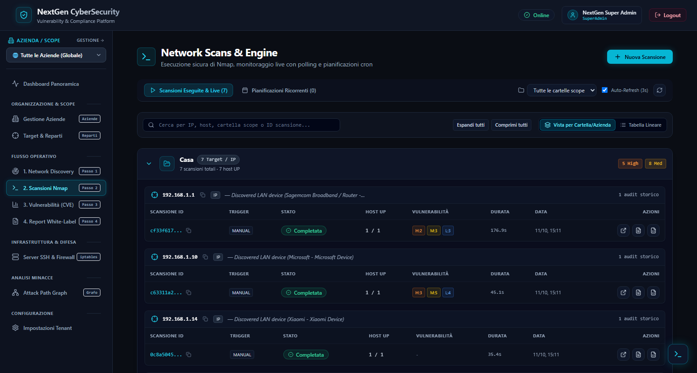

### Cosa vedi sullo schermo
- La tabella con lo storico delle scansioni passate e in corso: bersaglio, profilo utilizzato, data di avvio, durata, stato (In corso, Completata, Annullata, Fallita) e il conteggio delle vulnerabilità rilevate.
- Pulsanti rapidi per vedere i dettagli o scaricare i report.
- Il pulsante principale in alto a destra per aprire la configurazione guidata di un nuovo test.

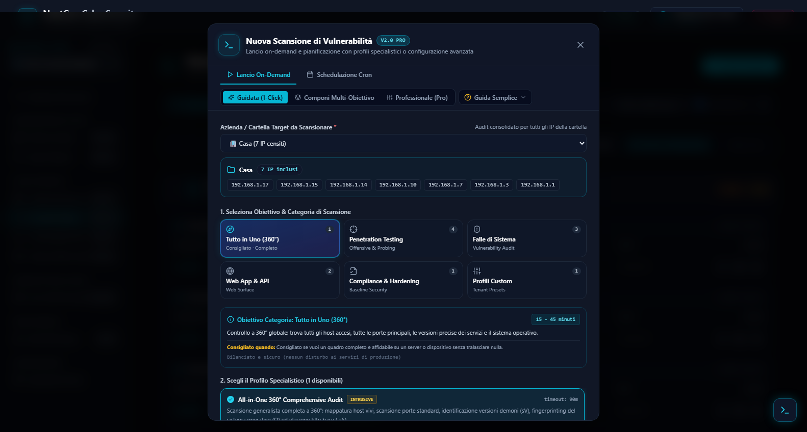

### La Finestra Unificata "Nuova Scansione" (Scanning Studio 360° & Master Presets)
Quando premi "Nuova Scansione", si apre l'interfaccia unificata di **Scanning Studio 360°** riprogettata a 2 livelli per coniugare immediatezza a 1-clic e controllo totale:

1. **Scelta del Bersaglio:** puoi scegliere se scansionare un singolo computer oppure un intero reparto o azienda. Grazie al `CompanyContext`, la tendina propone **esclusivamente i target appartenenti all'azienda attualmente selezionata**, con visualizzazione immediata del conteggio e dei chip degli indirizzi IP censiti.
2. **Livello 1 · I 4 Master Presets Intelligenti (1-Click Launch):**
   - **Audit 360° Sicurezza Generale (`-sS -sV -O -T4 --open`):** Scansione bilanciata su top 1000 porte, banner versioning e OS fingerprinting (`SAFE`, durata stimata 15-30 min).
   - **Ricognizione Rapida (Fast Sweep) (`-F -sS -T4 --open`):** Sweep lampo per inventariare gli host accesi e verificare le top 100 porte essenziali (`SAFE`, durata 1-3 min).
   - **Audit Vulnerabilità & CVE Exploit (`-sV -O --version-intensity 7 --script=vuln -T4 --open`):** Audit offensivo profondo con script attivi NSE di vulnerabilità e rilevamento exploit RCE noti (`INTRUSIVE`, durata 30-60 min).
   - **Perimetro Web App & API Surface (`-sV -p 80,443,8000,8080,8443,8888,3000,5000,9000 -T4 --open`):** Ispezione dedicata delle superfici HTTP/HTTPS, API REST, reverse proxy e certificati (`SAFE`, durata 5-15 min).
   *Ogni card preset dispone del pulsante diretto "Personalizza parametri ⚙️" per passare al volo allo Studio 360°.*
3. **Livello 2 · Scanning Studio 360° (Fine-Tuning Granulare):**
   - **Scope Porte Bersaglio:** Top 100 (-F), Top 1000 Standard, Servizi Critici & RCE, Web & API, Tutte le 65535 porte (-p-) o range arbitrari personalizzati con validazione reattiva.
   - **Timing Template Interattivo:** T1 (Sneaky) .. T5 (Insane).
   - **Sonde & Tecniche di Scansione:** SYN Stealth (-sS), ACK Probe (-sA), Service Versioning (-sV), Deep Intensity 7 (--version-intensity 7), OS Detection (-O), Script Vulnerabilità (--script=vuln), Sonde UDP Critiche (-sU), Bypass Ping (-Pn), Solo porte aperte (--open).
   - **Salvataggio Tenant:** Memorizzazione immediata della configurazione personalizzata come nuovo Profilo Custom.
4. **Riquadro "Live Command Preview" & Live Invasiveness Meter:** ti mostra in caratteri verdi stile terminale l'esatto comando (`nmap <argomenti> <target>`) che verrà eseguito sul server, con badge di sicurezza e calcolo in tempo reale dell'invasività (`SAFE` vs `INTRUSIVE`).
5. **Gate di Consenso Obbligatorio (Tassonomia di Invasività):** se viene selezionato un profilo intrusivo o attivati script vulnerabilità penetrativi, la finestra mostra un vistoso cartello ambra di avviso e ti obbliga a spuntare la casella di autorizzazione formale prima di sbloccare il tasto di avvio.

---

### 🧠 Cosa Fa il Backend Dietro le Quinte (Nmap, Sicurezza & Docker)

Mentre sullo schermo vedi semplicemente una barra di caricamento o una tabella, nel server Go e nel container Linux si attiva un'architettura complessa e rigorosa:

```
[ Input da NewScanModal ]
           │
           ▼ 1. Validazione & Deny-List (CheckTargetScope & Anti-Rebinding)
    [ Validatore Go ]
           │
           ▼ 2. Costruzione Argomenti Sicuri (BuildSafeArguments con delimitatore POSIX '--')
[ Argomenti Sanitizzati ]
           │
           ▼ 3. Esecuzione Diretta senza Shell di Sistema (exec.CommandContext)
[ Container Docker (CAP_NET_RAW) ] ──> Nmap emette XML su Stdout (Zero scritture su disco)
           │
           ▼ 4. Parser XML in Streaming + Correlazione CVE + Eventi SSE in Tempo Reale
[ Database PostgreSQL & Frontend React ]
```

#### 1. Esecuzione Diretta senza Shell (Zero Command Injection)
Il backend **non** usa mai interpreti di comandi come `/bin/sh -c` o `bash -c`. Nmap viene eseguito direttamente a livello di sistema operativo tramite la chiamata `exec.CommandContext(ctx, "nmap", args...)`. Questo garantisce l'impossibilità matematica di attacchi di tipo *Command Injection*: nessun carattere malevolo (come `;`, `&&`, `|`, `$()`) potrà mai essere interpretato dalla shell.

#### 2. Il Delimitatore di Sicurezza POSIX `--`
Nmap riceve sempre gli argomenti costruiti dalla funzione `BuildSafeArguments`:
```go
finalArgs = append(finalArgs, "-oX", "-") // Output XML su standard output
finalArgs = append(finalArgs, validatedArgs...)
finalArgs = append(finalArgs, "--")       // <--- DELIMITATORE DI SICUREZZA POSIX
finalArgs = append(finalArgs, target)
```
**Perché c'è `--` prima del bersaglio?**  
Nello standard POSIX, il doppio trattino `--` ordina al programma: *"da questo punto in poi, tutto ciò che segue è esclusivamente un bersaglio, non interpretare nulla come flag o comando anche se per assurdo iniziasse con un trattino `-`"*. Questo neutralizza qualsiasi tentativo di ingannare Nmap con finti indirizzi malevoli.

#### 3. Zero Scritture su Disco (`-oX -`)
Il backend impone sempre il parametro `-oX -`. Questo indica a Nmap di **non creare alcun file temporaneo sul disco**, ma di convogliare l'output XML direttamente nello standard output (in memoria RAM). Il backend riceve i dati direttamente in un buffer di memoria (`bytes.Buffer`), azzerando l'usura dell'hard disk e impedendo che il server esaurisca lo spazio di archiviazione dopo migliaia di scansioni.

#### 4. Barriere di Sicurezza sul Bersaglio (Deny-List & Anti-Rebinding DNS)
Prima che Nmap possa partire, la funzione `validator.CheckTargetScope` controlla l'indirizzo e blocca sul nascere:
- Scansioni contro `127.0.0.1` (loopback) per impedire all'applicazione di attaccare se stessa.
- Scansioni contro il bridge interno di Docker (`172.17.0.0/16`).
- Scansioni contro gli indirizzi di metadati dei cloud provider (es. `169.254.169.254` di AWS o Google Cloud).
- Tentativi di *DNS Rebinding*: se viene fornito un nome di dominio, il backend risolve preventivamente l'IP per verificare che non punti a risorse interne protette.

#### 5. Minimo Privilegio nel Container Docker
Nel file `docker-compose.yml`, il container backend non gira come amministratore di root illimitato: gli è assegnata unicamente la capability Linux `CAP_NET_RAW` (indispensabile per costruire pacchetti TCP/SYN grezzi per le scansioni stealth). La capability `CAP_NET_ADMIN` è stata revocata per garantire il massimo livello di isolamento.

---

### ⚙️ L'Orchestratore Backend (`ScanOrchestrator`): Coda, Fasi e Filtro Spenti

Nel file `backend/internal/service/scan_orchestrator.go`, un orchestratore dedicato coordina il lavoro:

1. **Il Worker Pool Asincrono:** Quando avvii una scansione, la chiamata API non si blocca ad aspettare. La scansione viene salvata nel database in stato `QUEUED` e inserita in una coda in memoria gestita tramite canali Go (`chan *ScanJob` da 100 posti). Due worker paralleli (Goroutine) elaborano al massimo 2 scansioni alla volta per non saturare la CPU o la banda di rete.
2. **Le 5 Fasi in Tempo Reale via SSE (Server-Sent Events):** Il server comunica continuamente con il tuo browser inviando messaggi in tempo reale:
   - **`HOST_DISCOVERY` (10%):** Verifica rapida se la macchina è accesa e risponde.
   - **`PORT_SCAN` (25%):** Bussata alle porte di rete previste dal profilo scelto.
   - **`SERVICE_DETECTION` (60%):** Invio di probe per scoprire il nome e la versione esatta dei programmi attivi.
   - **`CVE_CORRELATION` (80%):** Correlazione con il catalogo interno delle vulnerabilità CVE e calcolo del punteggio di gravità CVSS.
   - **`COMPLETED` (100%):** Calcolo delle statistiche riassuntive e salvataggio finale su PostgreSQL.
3. **Il Filtro degli Host Spenti ("Alive-Only"):** Se si scansiona un intero reparto con decine di indirizzi, solo alcuni computer saranno accesi. Il motore scarta automaticamente tutte le macchine che risultano spente (`status == down`), salvando nel database solo gli host realmente attivi ed evitando di inquinare i grafici e i report con macchine inesistenti.
4. **Il Meccanismo del Tasto "Annulla Scansione" (Graceful Shutdown):** Quando premi "Annulla", il backend recupera il contesto di quella scansione e invia a Nmap un segnale gentile di chiusura **`SIGTERM`**, concedendogli **3 secondi di tolleranza (`WaitDelay`)** per liberare le porte di rete prima di inviare un forzato `SIGKILL`. Lo stato diventa immediatamente `CANCELLED` e il sistema torna subito pronto.

---

### 📋 Il Vocabolario dei Flag di Nmap

Per capire cosa fanno i profili, ecco cosa significano i singoli comandi di Nmap usati nel sistema:
- **`-sS` (SYN Stealth Scan):** Manda un pacchetto con flag TCP SYN senza completare la connessione a tre vie (*half-open*). È velocissimo, discreto e non crea una sessione completa.
- **`-sT` (TCP Connect Scan):** Completa l'intera connessione TCP. Più rumoroso nei log del bersaglio, ma funziona anche senza privilegi di rete grezzi.
- **`-sU` (UDP Scan):** Scansiona porte che usano il protocollo UDP (es. DNS, Syslog, SNMP).
- **`-sV` (Version Detection):** Interroga attivamente le porte aperte per farsi restituire i banner e identificare il programma esatto e la sua versione (es. `Apache httpd 2.4.49`).
- **`-O` (OS Fingerprinting):** Esamina le risposte ai pacchetti per indovinare il sistema operativo installato (es. `Linux 5.10` o `Windows Server 2022`).
- **`-p <porte>`:** Limita l'indagine a specifiche porte numeriche per non perdere tempo (es. `-p 80,443`).
- **`-p-`:** Forza Nmap a controllare **tutte le 65.535 porte TCP** esistenti.
- **`-F` (Fast Scan):** Controlla solo le 100 porte più usate al mondo.
- **`-T0 .. -T5` (Timing & Performance):** Regola l'aggressività: `-T2` è lento e furtivo (stealth), `-T3` è normale, `-T4` è veloce e ottimizzato per reti locali o server moderni.
- **`-Pn` (No Ping):** Dice a Nmap di non controllare se il computer risponde al ping: dà per scontato che sia acceso e scansiona subito le porte (essenziale per server con firewall che bloccano l'ICMP).
- **`-sn` (Ping Sweep / No Port Scan):** Si limita a scoprire quali computer sono accesi senza scansionarne le porte.
- **`--open`:** Chiede a Nmap di restituire nell'output solo le porte che sono realmente aperte, ignorando quelle chiuse o filtrate.
- **`--script=vuln`:** Esegue gli script ufficiali dell'archivio NSE (Nmap Scripting Engine) dedicati a verificare la presenza di vulnerabilità ed exploit noti.
- **`--version-intensity <0-9>`:** Regola quanto a fondo Nmap deve interrogare un servizio per capirne la versione (il valore 7 garantisce altissima accuratezza).
- **`--version-all`:** Forza Nmap a provare ogni singola firma di riconoscimento senza esclusioni.

---

### 🔍 Enciclopedia dei 14 Profili di Scansione Implementati

Ecco l'elenco completo dei 14 profili preconfigurati nel file `backend/internal/scanner/profiles.go`, con il comando esatto generato, la spiegazione operativa e la motivazione tecnica:

| Categoria | Nome Profilo | Comando Generato ed Eseguito | Perché questi flag? Cosa fa nel server? | Invasività |
| :--- | :--- | :--- | :--- | :--- |
| **All-in-One** | **All-in-One 360° Comprehensive Audit** | `nmap -sS -sV -O --script=vuln -T4 --open -oX - -- <target>` | **L'audit completo:** esegue una scansione SYN veloce (`-sS`), identifica le versioni dei demoni (`-sV`), deduce il sistema operativo (`-O`), scatena la libreria di vulnerabilità note (`--script=vuln`) e isola solo le porte aperte (`--open`). Timeout massimo: 90 minuti. | **INTRUSIVE** *(Gate Obbligatorio)* |
| **Discovery** | **Fast Discovery** | `nmap -T4 -F -oX - -- <target>` | **Ricognizione rapida:** scansiona solo le 100 porte più diffuse al mondo (`-F`) con velocità `-T4`. Si conclude in meno di 60 secondi ed è la scelta ideale per verificare al volo se un server espone i servizi tipici. | **SAFE** |
| **Discovery** | **LAN Discovery** | `nmap -sn -PE -PS21,22,80,443,445,8080,8443,3389,53,8000 -PU53,137,161,5353 -T4 -oX - -- <target>` | **Sonar della rete aziendale:** non fa port scan (`-sn`), ma invia pacchetti ICMP Echo (`-PE`), sonde SYN su porte frequenti (`-PS`) e sonde UDP su porte tipiche LAN (`-PU`) per risvegliare e censire ogni dispositivo collegato (PC, telefoni, stampanti). Timeout: 2 minuti. | **SAFE** |
| **Discovery** | **Fast Ping & Host Sweep (LAN)** | `nmap -sn -PE -PS22,80,443,445 -T4 -oX - -- <target>` | Versione ancora più snella di ping sweep focalizzata solo sulle 4 porte fondamentali dei sistemi server (SSH, HTTP, HTTPS, SMB). | **SAFE** |
| **System Flaws** | **Standard Service Scan** | `nmap -sV -T4 -oX - -- <target>` | **Scansione standard dei servizi:** esamina le top 1000 porte TCP con interrogazione di versione (`-sV`) a velocità ottimale `-T4`. È il profilo consigliato per la maggior parte delle verifiche periodiche. | **SAFE** |
| **System Flaws** | **OS & System Daemon Flaws Audit** | `nmap -sV -O --version-intensity 7 --script=vuln -T4 -oX - -- <target>` | **Audit approfondito dei servizi di sistema:** alza l'intensità di versioning al livello 7 su 9, identifica l'OS con fingerprinting avanzato (`-O`) e lancia gli script di vulnerabilità per individuare bug nei demoni di base (Samba, RPC, SSH). | **INTRUSIVE** *(Gate Obbligatorio)* |
| **System Flaws** | **Critical Services & RCE Surface** | `nmap -sV -p 21,22,23,25,53,80,110,135,139,143,443,445,1433,1521,3306,3389,5432,5900,6379,8080,8443 --script=vuln -T4 -oX - -- <target>` | **Caccia alle porte più pericolose:** limita l'analisi esclusivamente alle porte associate a database (PostgreSQL 5432, MySQL 3306, Redis 6379), desktop remoti (RDP 3389, VNC 5900) e servizi esposti a bug di Remote Code Execution (RCE). | **INTRUSIVE** *(Gate Obbligatorio)* |
| **Web App** | **Web & API Surface Audit** | `nmap -sV -p 80,443,8000,8080,8443,8888,3000,5000,9000 -T4 --open -oX - -- <target>` | **Mappatura delle applicazioni web:** scansiona miratamente le porte tipicamente impiegate da siti web, API REST, reverse proxy (Nginx, Traefik, Apache) e container applicativi (Node, Python, Go). | **SAFE** |
| **Web App** | **Full Web Stack Deep Versioning** | `nmap -sV --version-all -p 80,443,8008,8080,8443,9090,9443 -T4 -oX - -- <target>` | **Versioning approfondito del web stack:** con `--version-all` costringe Nmap a testare ogni singola firma per identificare librerie nascoste, framework obsoleti e certificati TLS difettosi. | **SAFE** |
| **Penetration Test** | **Full Deep Scan** | `nmap -p- -sV -O -T4 -oX - -- <target>` | **Controllo a tappeto su tutto lo spettro:** scansiona tutte le **65.535 porte TCP** (`-p-`). Nessun servizio nascosto su porte strane (es. una backdoor sulla porta 49152) può sfuggire. Può richiedere fino a 4 ore di esecuzione. | **INTRUSIVE** *(Gate Obbligatorio)* |
| **Penetration Test** | **Stealth SYN Penetration Audit** | `nmap -sS -Pn -T2 --open -oX - -- <target>` | **Test invisibile e silenzioso:** usa timing `-T2` (molto lento) per non far scattare gli allarmi dei sistemi anti-intrusione (IDS/IPS), disabilita il ping (`-Pn`) e invia solo pacchetti SYN grezzi. | **SAFE** |
| **Penetration Test** | **Firewall & Filter Bypass Check** | `nmap -sA -Pn -T3 -oX - -- <target>` | **Studio dei filtri del firewall:** manda pacchetti con flag TCP ACK (`-sA`). Non apre connessioni, ma analizza le risposte RST per capire se il firewall aziendale è di tipo *Stateful* (moderno) o *Stateless* (vecchio e vulnerabile a bypass). | **INTRUSIVE** *(Gate Obbligatorio)* |
| **Penetration Test** | **Specialized UDP Critical Services** | `nmap -sU -p U:53,69,123,161,514,623,5353 -T4 -oX - -- <target>` | **Scansione specialistica UDP:** i pacchetti UDP sono senza connessione e lenti da scansionare. Questo profilo isola solo i servizi critici che usano UDP: DNS (53), TFTP (69), NTP (123), SNMP (161), Syslog (514), IPMI (623) e mDNS (5353). | **SAFE** |
| **Compliance** | **Legacy & Insecure Protocol Check** | `nmap -sV -p 21,23,79,110,143,512,513,514 -T3 -oX - -- <target>` | **Controllo di conformità (es. ISO 27001 / NIS2):** cerca i protocolli obsoleti che trasmettono password in chiaro non cifrate sulla rete locale: Telnet (23), FTP (21), Finger (79), Rlogin (513), Rsh (514). | **SAFE** |

---

### Descrizione dei Tasti e Controlli
| Elemento a Schermo | Cosa Fa sul Frontend (Schermo) | Cosa Fa nel Backend (Dietro le Quinte) |
| :--- | :--- | :--- |
| **Pulsante "+ Nuova Scansione"** | Apre la finestra di configurazione guidata con selezione target e profili. | Recupera la lista aggiornata dei target dell'azienda attiva e l'elenco dei profili di scansione supportati. |
| **Menu a Tendina "Seleziona Profilo"** | Ti permette di scegliere tra i 14 profili. Cambia al volo la descrizione, la categoria, il badge di invasività e il comando visualizzato nell'anteprima verde. | Fornisce la definizione del profilo con i parametri raccomandati e il livello di invasività associato. |
| **Casella "Dichiaro di essere autorizzato"** | Si attiva solo per profili invasivi: spuntandola, il pulsante di avvio passa da grigio disabilitato a blu cliccabile. | Il Frontend include la conferma esplicita nel messaggio inviato al server. |
| **Pulsante "Lancia Scansione"** | Chiude la modale, aggiunge una nuova riga in stato "In Esecuzione" nella tabella e mostra la rotella di caricamento. | Invia `POST /api/v1/scans`. Il Backend valida il bersaglio (anti-rebinding), costruisce gli argomenti con il delimitatore POSIX `--`, accoda il job nel worker pool ed esegue Nmap all'interno del container Docker con capability `CAP_NET_RAW`. |
| **Pulsante "Annulla Scansione" (icona Stop/X)** | Chiede conferma e trasforma lo stato della scansione in "Annullata". | Invia `POST /api/v1/scans/{id}/cancel`. L'Orchestratore invia un segnale `SIGTERM` al processo Nmap sul server con 3 secondi di tolleranza prima del `SIGKILL`, liberando subito la memoria del server. |

---

## Feature 7 · Dettaglio della Scansione e Confronto Storico (Scan Detail & Scan Diff)

Cliccando sull'icona dell'occhio in una qualsiasi scansione, accedi al suo fascicolo approfondito (`/scans/:id`).


### Cosa vedi sullo schermo
- **Intestazione:** tempo impiegato, indirizzo IP analizzato, numero di porte trovate aperte e vulnerabilità scoperte.
- **Tab 1 · Porte e Servizi:** l'elenco chiaro di ogni porta aperta (es. porta 80 per il web, porta 22 per l'amministrazione) con il nome del programma che ci risponde e la versione esatta.
- **Tab 2 · Log in Tempo Reale:** se la scansione è ancora in corso, vedi i messaggi dello scanner scorrere riga per riga dal vivo.
- **Tab 3 · Confronto Temporale (Scan Diff):** una funzione formidabile che mette a confronto questa scansione con l'ultima effettuata sullo stesso computer.

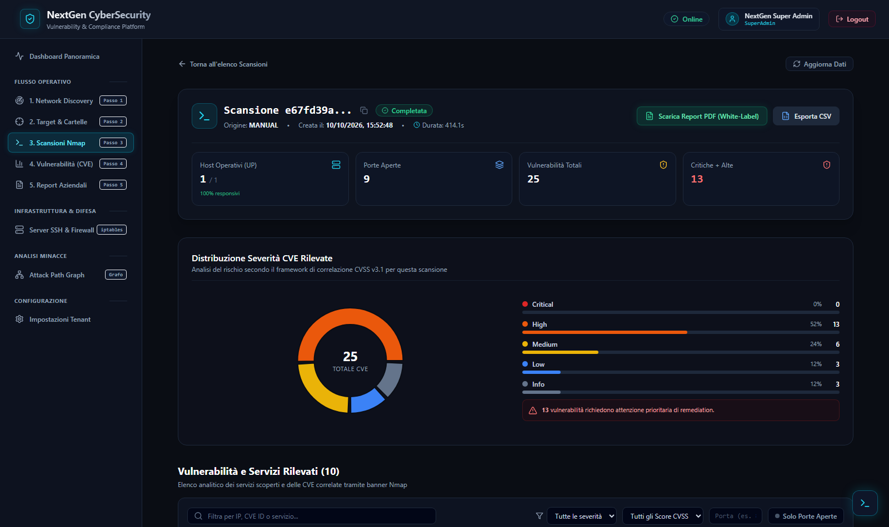

### Il Tab "Scan Diff" (Come Capire i Cambiamenti nel Tempo)
Questa vista suddivide i problemi in tre categorie visive chiarissime:
- 🟢 **Vulnerabilità Risolte:** problemi che c'erano nella scansione precedente e che oggi non ci sono più (segno che i tecnici hanno fatto un buon lavoro di riparazione!).
- 🔴 **Nuove Vulnerabilità:** problemi che prima non c'erano e sono comparsi adesso (nuovi pericoli da sanare subito).
- 🟡 **Vulnerabilità Persistenti:** problemi vecchi che erano presenti prima e sono ancora lì, non ancora risolti.

### Descrizione dei Tasti e Controlli
| Elemento a Schermo | Cosa Fa sul Frontend (Schermo) | Cosa Fa nel Backend (Dietro le Quinte) |
| :--- | :--- | :--- |
| **Selettore Schede (Tab: Riepilogo / Log / Diff)** | Cambia la vista interna della pagina senza dover ricaricare l'intera schermata. | Se selezioni "Log", il browser richiede un ticket di trasmissione protetto valido 30 secondi (`POST /api/v1/auth/stream-ticket`) e apre un flusso continuo SSE con il server. |
| **Pulsante "Scarica PDF Scansione"** | Scarica istantaneamente il documento PDF dedicato a questo specifico test. | Il Backend compone al volo il documento con la libreria nativa `go-pdf/fpdf v0.9.0` e lo invia al tuo computer con download automatico. |
| **Pulsante "Torna all'Elenco Scansioni"** | Ti riporta comodamente alla pagina generale `/scans`. | Navigazione interna del browser senza chiamate al server. |

---

## Feature 8 · Archivio delle Vulnerabilità Trovate (Findings & CVE Intelligence)

La pagina `/findings` è il catalogo completo di tutte le debolezze informatiche scoperte su tutte le macchine della tua azienda.

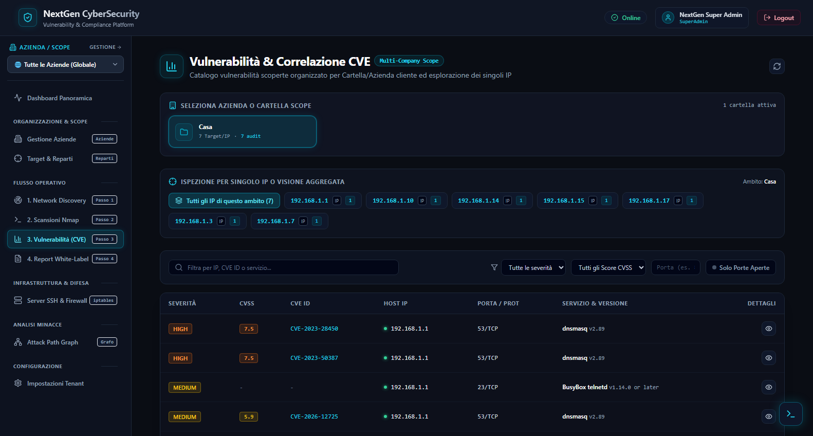

### Cosa vedi sullo schermo
- **Una barra di ricerca intelligente:** dove puoi digitare il nome di un programma (es. "OpenSSH", "Apache", "Windows") o un codice di vulnerabilità per trovare subito dove si trova nella tua rete.
- **Filtri rapidi colorati per livello di pericolo:**
  - *Critica (Rosso):* pericolo massimo, può consentire a chiunque di prendere il controllo della macchina da remoto.
  - *Alta (Arancione):* difetto grave da correggere rapidamente.
  - *Media (Giallo):* difetto moderato.
  - *Bassa (Blu):* piccola anomalia o informazione di configurazione.
- **Tabella dettagliata con punteggio CVSS:** un punteggio internazionale da 0.0 a 10.0 che esprime oggettivamente la gravità della falla.
- **Scheda di Rimedio Espandibile:** cliccando su una riga, la tabella si allarga per mostrarti la spiegazione della falla e il consiglio pratico su come correggerla.

### Descrizione dei Tasti e Controlli
| Elemento a Schermo | Cosa Fa sul Frontend (Schermo) | Cosa Fa nel Backend (Dietro le Quinte) |
| :--- | :--- | :--- |
| **Barra di Ricerca Testuale** | Filtra istantaneamente la tabella mentre scrivi ogni lettera. | Interroga le API con parametri di ricerca testuale cercando corrispondenze su IP, software o codice CVE. |
| **Pulsanti Filtro Severità (Critica, Alta, Media, Bassa)** | Cliccandone uno, nasconde tutti gli altri livelli per farti concentrare solo sulle emergenze. | Esegue una richiesta al Backend filtrando per la colonna `severity` nel database. |
| **Freccia di Espansione Riga (Accanto al nome)** | Fa scendere un pannello dettagliato con la spiegazione del pericolo e il riquadro verde "Rimedio Raccomandato" (*Remediation*). | Mostra i testi descrittivi già scaricati oppure, se mancanti, il Backend interroga il database ufficiale americano NIST NVD per arricchire la scheda con la descrizione internazionale. |

---

## Feature 9 · Mappa Visuale dei Vettori d'Attacco e Punti Critici (Attack Path & Chokepoints)

Questa è una delle funzionalità più sofisticate e innovative della piattaforma (`/attack-path`): invece di darti solo un elenco noioso di problemi separati, **ti disegna una mappa interattiva che mostra come un attaccante potrebbe concatenare le vulnerabilità per penetrare fino al cuore della tua azienda**.

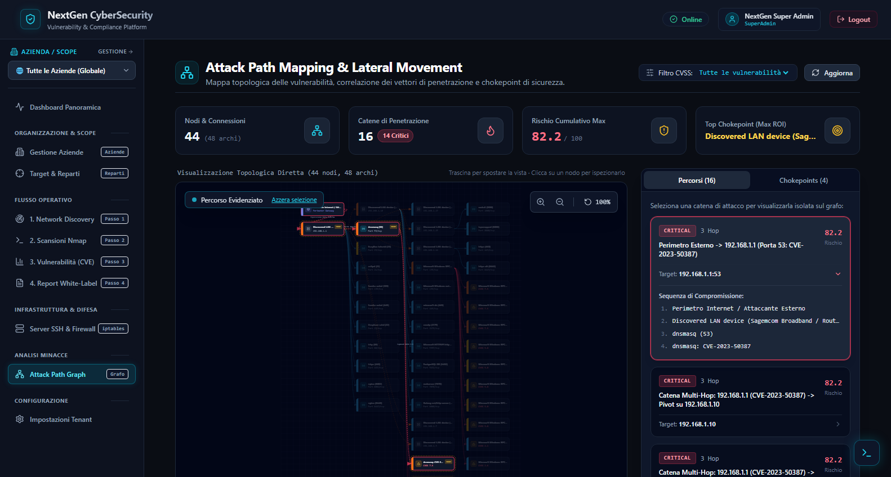

### Cosa vedi sullo schermo
- **Un grande Grafo Interattivo a Nodi SVG:** 
  - I cerchi rappresentano i computer, i server o le postazioni di lavoro.
  - Il nodo con il simbolo del teschio o del mirino rosso rappresenta il punto d'ingresso esterno dell'hacker.
  - Le linee che collegano i cerchi rappresentano i **vettori d'attacco** (le strade percorribili dal ladro informatico).
  - Le linee tratteggiate indicano *relazioni dedotte e inferite*, con un badge percentuale che ti dice quanto il sistema è sicuro di quella connessione.
- **Pannello Laterale di Dettaglio del Nodo:** cliccando su qualsiasi computer nel disegno, sulla destra compare la sua scheda con tutte le porte esposte e le sue vulnerabilità.

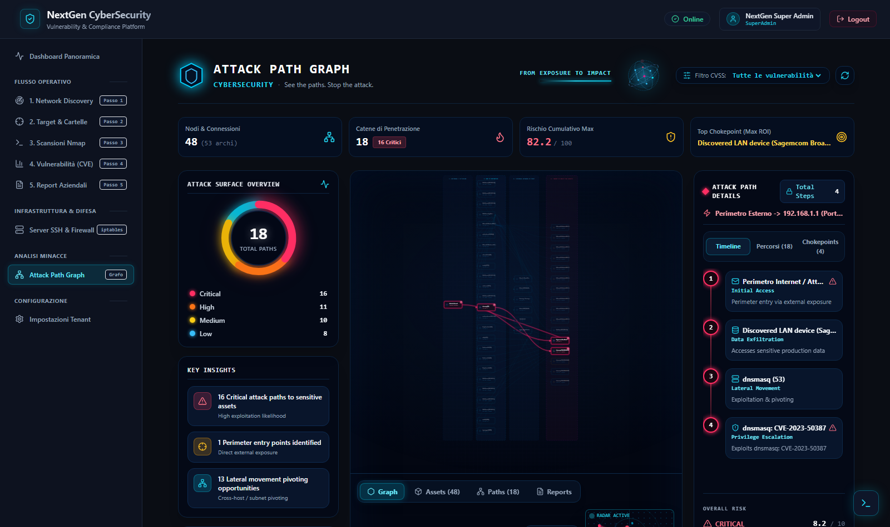

- **La Scheda "Chokepoints" (Punti di Strozzatura):** un elenco dei nodi più critici della rete. Un "chokepoint" è come un ponte levatoio o un passaggio obbligato: se un attaccante deve per forza passare da lì per arrivare a tutti gli altri server, proteggere quel singolo punto neutralizza l'intera catena di attacco!

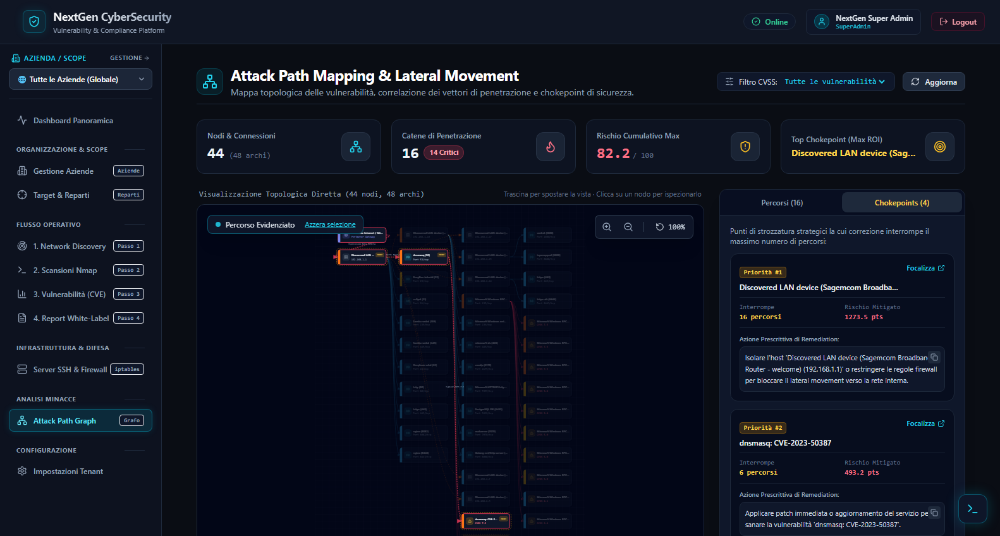

### Descrizione dei Tasti e Controlli
| Elemento a Schermo | Cosa Fa sul Frontend (Schermo) | Cosa Fa nel Backend (Dietro le Quinte) |
| :--- | :--- | :--- |
| **Pulsanti Zoom In (+) e Zoom Out (-)** | Ingrandiscono o rimpiccioliscono la mappa visuale del grafo per consentirti di esplorare reti con decine di macchine. | Operazione interattiva puramente grafica nel browser (trasformazioni SVG vettoriali fluide). |
| **Pulsante "Reset Vista" (icona mirino al centro)** | Riposiziona automaticamente la mappa al centro dello schermo con il fattore di scala ottimale. | Ricalcola le coordinate centrali del riquadro grafico. |
| **Pulsante "Vista Prospettica 3D" (toggle 3D)** | Inclina il grafo applicando una prospettiva tridimensionale moderna ad alto impatto visivo. | Applica una matrice di trasformazione CSS tridimensionale al canvas. |
| **Cursore / Filtro Soglia CVSS** | Ti permette di nascondere i percorsi che hanno un punteggio di rischio inferiore a una certa soglia (ad esempio mostrare solo i cammini con rischio > 7.0). | Ricalcola istantaneamente il grafo visualizzato escludendo gli archi sotto-soglia. |
| **Clic su un Cerchio (Nodo)** | Seleziona la macchina, illumina i percorsi che la attraversano e apre il cassetto laterale con tutte le informazioni tecniche. | Evidenzia il sotto-albero dei cammini d'attacco associati. |
| **Pulsante Scheda "Chokepoints"** | Passa dalla vista del disegno alla tabella riassuntiva dei nodi di strozzatura prioritari. | Interroga `GET /api/v1/attack-paths/chokepoints`. Il Backend calcola la centralità di ciascun nodo applicando una rigorosa **formula di rischio probabilistico combinato** ($P = 1 - \prod(1 - p_i)$) che valuta la probabilità reale di penetrazione. |

---

## Feature 10 · Controllo dei Server Remoti e Protezione Firewall (SSH & iptables GUI)

La sezione `/ssh-servers` permette agli amministratori di gestire i propri server Linux aziendali e di intervenire direttamente sul loro firewall per bloccare le minacce, il tutto comodamente dalla finestra del browser e senza dover usare programmi esterni come PuTTY.

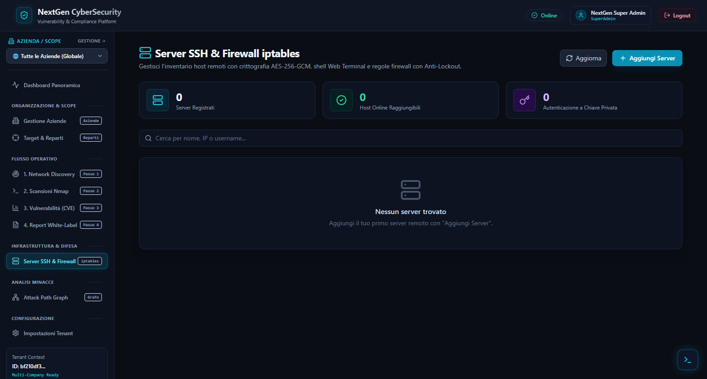

### Cosa vedi sullo schermo
- L'elenco dei server registrati con nome, indirizzo IP, porta, utente e indicatore di stato visivo (pallino verde se il server è raggiungibile, grigio o rosso se non risponde).
- Il pulsante per registrare un nuovo server.
- I pulsanti di azione rapida su ogni server: Prova di connessione, Terminale Web, Configurazione Firewall.

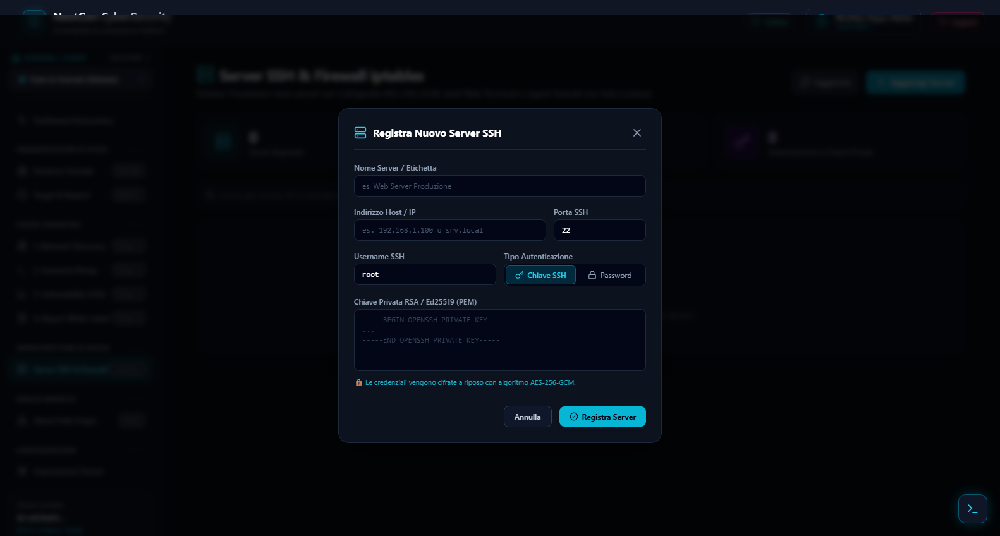

### Il Terminale Web Integrato e il Firewall con Timer di Salvataggio
- **Terminale Web (xterm.js):** cliccando sull'icona della console, si apre una vera finestra di comando nera identica al terminale Linux, con supporto completo ai tasti di direzione, colori e comandi.
- **Firewall iptables con Anti-Lockout Safety Timer:** quando modifichi le regole del firewall per chiudere una porta, l'applicazione applica un timer di sicurezza di 60 secondi: se la regola che hai inserito per sbaglio ti chiudesse fuori impedendoti di amministrare il server, alla scadenza del timer il server ripristina automaticamente le vecchie regole sane, salvandoti da blocchi disastrosi!

### Descrizione dei Tasti e Controlli
| Elemento a Schermo | Cosa Fa sul Frontend (Schermo) | Cosa Fa nel Backend (Dietro le Quinte) |
| :--- | :--- | :--- |
| **Pulsante "+ Aggiungi Server"** | Apre la finestra per inserire Nome del Server, Indirizzo IP, Porta (default 22), Utente e Password (oppure Chiave privata SSH). | Quando premi Salva (`POST /api/v1/ssh/servers`), il Backend prende la password o la chiave privata e la **cifra nel database con algoritmo militare AES-256-GCM**. Nessuno potrà mai leggere la credenziale in chiaro, nemmeno accedendo al database PostgreSQL. |
| **Pulsante "Test Connessione" (icona fulmine/spina)** | Mostra una rotellina e poi un messaggio verde "Connesso con successo" con la versione di Linux del server, oppure un messaggio di errore chiaro se le credenziali sono errate. | Invia `POST /api/v1/ssh/servers/{id}/test-connection`. Il Backend decifra temporaneamente la password in memoria, apre un socket SSH verso la porta 22 del server, effettua l'handshake e restituisce l'esito al browser. |
| **Pulsante "Apri Terminale Web" (icona `>_`)** | Apre a tutto schermo l'emulatore di terminale nero pronto a ricevere i tuoi comandi. | Il Backend apre una connessione WebSocket protetta (`/ws/v1/ssh/servers/{id}/terminal`), alloca una pseudo-terminale Linux (PTY) sul server remoto e fa da ponte in tempo reale tra la tua tastiera e il sistema operativo. |
| **Pulsante "Configura Firewall"** | Mostra l'elenco delle regole attive del firewall Linux (`iptables`) con pulsanti per aggiungere o rimuovere porte. | Legge le regole remote ed esegue l'applicazione con il meccanismo di sicurezza a due fasi (*Apply con Safety Timer* e *Confirm definitivo*). Se non confermi entro il tempo stabilito, un processo distaccato sul server (*watchdog con nohup*) annulla le modifiche tornando indietro al backup precedente. |

---

## Feature 11 · Centro Stampa Report Professionali (Reports Hub)

La sezione `/reports` è l'ufficio stampa della piattaforma: consente di trasformare tutte le verifiche tecniche in documenti eleganti, completi e ufficiali, pronti per essere consegnati a clienti, revisori o alla direzione aziendale.

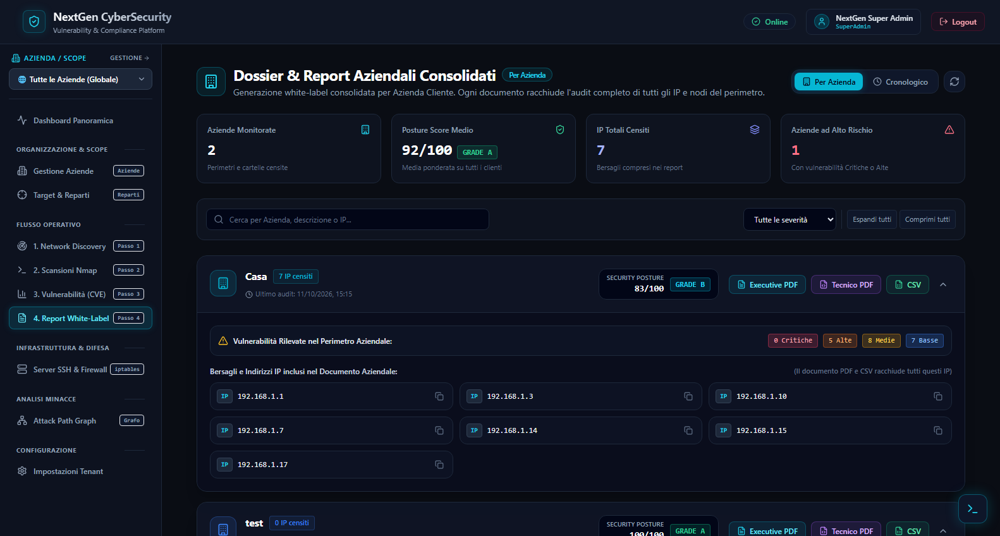

### Cosa vedi sullo schermo
- Lo storico di tutti i report generati in precedenza.
- Il pulsante in evidenza per **scaricare il Dossier Consolidato dell'Azienda Attiva**.
- I pulsanti di download differenziati per ciascun tipo di destinatario:
  - **PDF Executive (Per la Direzione):** un documento sintetico di 2 pagine dense in formato A4, scritto senza gergo incomprensibile, con grafici a torta colorati, livello di sicurezza generale e i 5 problemi più urgenti da autorizzare per la spesa di riparazione.
  - **PDF Tecnico (Per i Sistemisti):** un documento approfondito e dettagliato con l'elenco completo di tutte le porte, tutti i comandi usati, ogni singola falla CVE con il suo codice e le istruzioni esatte per correggerla.
  - **CSV (Per Analisi ed Excel):** un file tabellare che puoi aprire con Microsoft Excel per fare filtri o allegarlo alla contabilità dei lavori.

### Descrizione dei Tasti e Controlli
| Elemento a Schermo | Cosa Fa sul Frontend (Schermo) | Cosa Fa nel Backend (Dietro le Quinte) |
| :--- | :--- | :--- |
| **Pulsante "Scarica Dossier Aziendale Consolidato"** | Avvia il download immediato del fascicolo completo che aggrega tutti i reparti e tutti gli IP dell'azienda selezionata. | Chiama `GET /api/v1/reports/company/{groupId}/download`. Il Backend raccoglie ricorsivamente tutti i risultati storici dell'azienda, calcola la postura di sicurezza normalizzata e compone un dossier PDF multipagina completo con intestazione personalizzata. |
| **Pulsante "Scarica PDF Executive" (accanto a una scansione)** | Scarica il riassunto manageriale su 2 pagine A4. | Il motore PDF Go impagina i grafici, le card riassuntive e le raccomandazioni di alto livello. |
| **Pulsante "Scarica PDF Tecnico"** | Scarica la perizia tecnica completa. | Compila la lista esaustiva dei finding con wrapping automatico del testo e dettagli tecnici. |
| **Pulsante "Scarica CSV"** | Scarica il file tabellare per fogli elettronici. | Estrae i dati secondo lo standard internazionale RFC 4180 con separatori corretti e codifica UTF-8. |

---

## Feature 12 · Personalizzazione del Marchio e Impostazioni (Settings)

La pagina `/settings` permette di configurare le preferenze generali della piattaforma e di personalizzare i documenti con il proprio marchio (modalità White-Label).

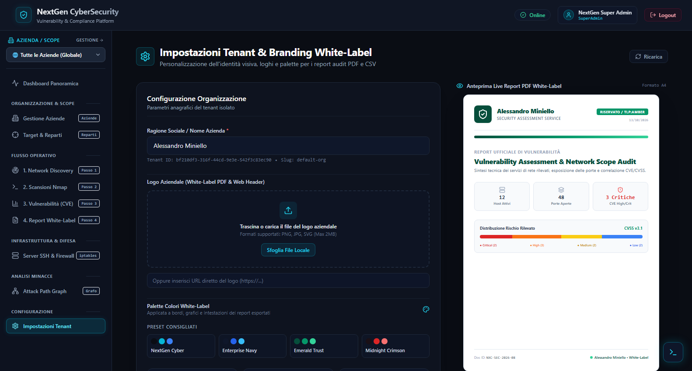

### Cosa vedi sullo schermo
- **Sezione Marchio Aziendale (Tenant Branding):** campi per impostare la ragione sociale, inserire l'indirizzo del logo aziendale e scegliere i due colori ufficiali (Primario e Secondario) tramite una comoda tavolozza grafica.
- **Anteprima Stampa:** un riquadro che ti mostra in anteprima come apparirà la copertina dei tuoi report PDF con il logo e i colori che hai scelto.
- **Sezione Aggiornamento Vulnerabilità (CVE Sync):** indica quando è stato aggiornato per l'ultima volta l'archivio delle vulnerabilità e quante falle sono censite.
- **Pulsante di Sincronizzazione con il NIST NVD:** per interrogare l'ente ufficiale americano e scaricare le nuove vulnerabilità scoperte nel mondo.

### Descrizione dei Tasti e Controlli
| Elemento a Schermo | Cosa Fa sul Frontend (Schermo) | Cosa Fa nel Backend (Dietro le Quinte) |
| :--- | :--- | :--- |
| **Selettore Colori Primario e Secondario** | Apre il selettore colore visivo e aggiorna istantaneamente l'anteprima a schermo. | Memorizza i codici esadecimali nel modulo. |
| **Pulsante "Salva Impostazioni Marchio"** | Mostra una notifica verde di salvataggio confermato. | Invia `PUT /api/v1/tenants/current/branding`. Il Backend aggiorna la riga dell'azienda nella tabella `tenants`, applicando i nuovi colori e logo a tutti i futuri PDF generati. |
| **Pulsante "Sincronizza Database CVE con NIST NVD"** | Mostra un'animazione di download e aggiorna il contatore delle vulnerabilità. | Invia `POST /api/v1/cve/sync`. Il Backend contatta le API ufficiali del National Vulnerability Database statunitense, scarica gli ultimi bollettini e li inserisce nel database locale per consultazioni future ultra-rapide anche senza internet. |

---

## Feature 13 · Console di Diagnostica in Tempo Reale (Live Debug Console `>_`)

La Live Debug Console è una speciale "scatola nera" integrata direttamente nell'applicazione, accessibile da qualsiasi schermata (anche prima del login).

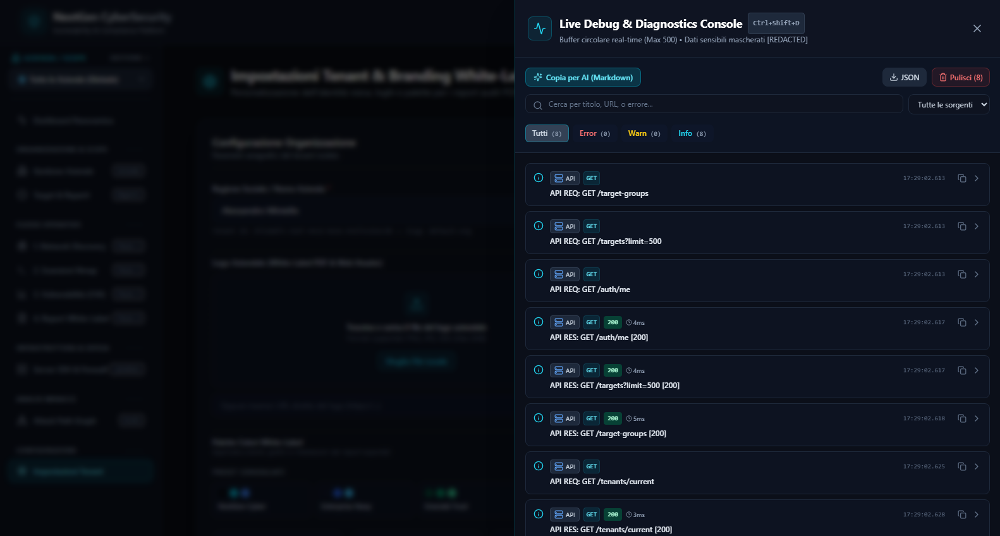

### Cosa vedi sullo schermo
- **Un pulsante circolare fluttuante in basso a destra con il simbolo `>_`** (puoi aprirla anche premendo la combinazione di tasti `Ctrl + Shift + D` sulla tastiera).
- **Un cassetto laterale scorrevole (Drawer):** che mostra il flusso continuo degli eventi tecnici che avvengono nel browser (richieste inviate al server, messaggi ricevuti in tempo reale, stati delle connessioni, eventuali messaggi di errore).
- **Filtri colorati:** per vedere solo gli errori o solo le chiamate riuscite.
- **Pulsante di esportazione sicura per l'Assistente:** un pulsante comodissimo che copia tutti i dati tecnici negli appunti formattati in Markdown, **oscurando automaticamente tutte le password, i token o i dati segreti** (`[REDACTED]`), consentendoti di incollarli all'assistente o al supporto tecnico in totale tranquillità.

### Descrizione dei Tasti e Controlli
| Elemento a Schermo | Cosa Fa sul Frontend (Schermo) | Cosa Fa nel Backend (Dietro le Quinte) |
| :--- | :--- | :--- |
| **Pulsante Fluttuante `>_` / Tasti `Ctrl+Shift+D`** | Fa comparire o scomparire il cassetto laterale di diagnostica senza interrompere il lavoro che stavi facendo. | Azione locale del browser gestita dal componente `DebugConsoleDrawer`. |
| **Pulsante "Filtra per Tipo" (HTTP, SSE, WS, ERROR)** | Isola specifici eventi per trovare subito quello che cerchi. | Filtra il buffer circolare di memoria (massimo 500 eventi conservati per non appesantire il computer). |
| **Pulsante "Esporta per Assistente AI (Markdown)"** | Copia l'intero registro negli appunti del computer con formattazione pulita e campi sensibili protetti. | Uno speciale filtro di sicurezza sostituisce al volo qualsiasi password o chiave con la dicitura `[REDACTED]`, garantendo zero fughe di dati. |
| **Pulsante "Pulisci Console" (icona cestino)** | Svuota la lista dei log sullo schermo. | Azzera il buffer temporaneo nella memoria del browser. |

---

## 17. Matrice di Sintesi Rapida di Ogni Tasto

Per facilitare la consultazione immediata, ecco la mappa riassuntiva di tutti i tasti dell'applicazione, suddivisi per pagina:

| Pagina / Schermata | Nome Tasto / Controllo | Effetto Visibile a Schermo (Frontend) | Cosa Accade nel Server (Backend) |
| :--- | :--- | :--- | :--- |
| **Login** | **Accedi** | Mostra caricamento e apre la Dashboard se corretto | Verifica hash password con Bcrypt ed emette token JWT |
| **Login** | **Icona Occhio** | Mostra/nasconde i caratteri della password | Nessuna (azione puramente visiva locale) |
| **Barra Laterale** | **Selettore Azienda** | Cambia l'azienda attiva in tutta la piattaforma | Filtra ricorsivamente reparti e IP per l'azienda scelta |
| **Dashboard** | **Card Vulnerabilità** | Porta a `/findings` con filtro preimpostato | Interroga solo le vulnerabilità di quella severità |
| **Aziende** | **+ Nuova Azienda** | Apre la finestra di inserimento | Prepara il modulo vuoto |
| **Aziende** | **Salva Azienda** | Aggiunge la nuova card aziendale alla lista | Salva la radice in `target_groups` (`parent_id = NULL`) |
| **Aziende** | **Mirino (Scope Attivo)** | Imposta l'azienda come filtro globale | Salva lo stato in memoria locale (`localStorage`) |
| **Aziende** | **Cestino (Elimina)** | Chiede conferma e rimuove la card | Esegue `DELETE` se non ci sono scansioni in corso |
| **Bersagli** | **+ Aggiungi Reparto** | Apre la finestra per creare un sotto-reparto | Salva il reparto collegandolo al padre (`parent_id != NULL`) |
| **Bersagli** | **+ Aggiungi Target** | Apre la finestra per inserire IP o CIDR | Esegue controllo di sicurezza (anti-rebinding) e salva |
| **Bersagli** | **Play (Scansiona Reparto)** | Apre la configurazione scansione per quel gruppo | Raccoglie tutti gli IP discendenti del reparto |
| **Discovery** | **Avvia Discovery** | Mostra barra di avanzamento del radar | Lancia Nmap ARP/Ping sweep e manda eventi via SSE |
| **Discovery** | **Importa nei Target** | Sposta i dispositivi selezionati nei bersagli | Inserisce i dispositivi scelti nella tabella `targets` |
| **Scansioni** | **+ Nuova Scansione** | Apre la finestra di configurazione guidata | Recupera i profili e bersagli disponibili |
| **Scansioni** | **Lancia Scansione** | Avvia il test e aggiunge la riga in esecuzione | Lancia processo Nmap isolato con flag di sicurezza |
| **Scansioni** | **Annulla Scansione** | Ferma la scansione e aggiorna lo stato | Invia `SIGTERM` al processo Nmap sul server |
| **Dettaglio Scansione** | **Tab Log Real-Time** | Mostra i messaggi dello scanner dal vivo | Chiede ticket monouso (30s) e apre stream SSE |
| **Dettaglio Scansione** | **Tab Scan Diff** | Mostra differenze: Risolte, Nuove, Persistenti | Calcola intersezione tra vulnerabilità attuali e passate |
| **Vulnerabilità** | **Filtri Severità** | Mostra solo Critiche, Alte, Medie o Basse | Filtra le righe per la colonna `severity` nel DB |
| **Vulnerabilità** | **Freccia Dettaglio** | Espande la scheda con spiegazione e rimedio | Mostra la raccomandazione salvata nel database |
| **Attack Path** | **Zoom + / -** | Ingrandisce o rimpicciolisce la mappa SVG | Trasformazione grafica vettoriale locale |
| **Attack Path** | **Vista 3D** | Inclina il grafo in prospettiva tridimensionale | Applica matrice prospettica CSS al contenitore |
| **Attack Path** | **Tab Chokepoints** | Mostra la tabella dei punti di strozzatura | Calcola centralità e rischio probabilistico combinato |
| **Server SSH** | **+ Aggiungi Server** | Apre finestra per inserire IP e credenziali | Cifra le credenziali con algoritmo militare AES-256-GCM |
| **Server SSH** | **Test Connessione** | Verifica se il server Linux risponde | Esegue handshake SSH reale sulla porta 22 remota |
| **Server SSH** | **Terminale Web** | Apre finestra di comando nera interattiva | Apre WebSocket e alloca pseudo-terminale Linux (PTY) |
| **Server SSH** | **Firewall** | Apre gestione regole con Anti-Lockout Timer | Applica regole con timer di rollback a 60 secondi |
| **Report** | **Dossier Aziendale** | Scarica il fascicolo PDF completo dell'azienda | Genera documento A4 aggregando tutti i reparti |
| **Report** | **PDF Executive** | Scarica sintesi di 2 pagine per i manager | Compila grafici e riassunti ad alto livello |
| **Report** | **PDF Tecnico** | Scarica documento con tutti i dettagli | Compila elenco esaustivo con istruzioni di rimedio |
| **Report** | **CSV** | Scarica file per Microsoft Excel | Estrae tabella dati secondo lo standard RFC 4180 |
| **Impostazioni** | **Salva Marchio** | Applica colori e logo all'anteprima | Salva preferenze in tabella `tenants` per i PDF |
| **Impostazioni** | **Sincronizza CVE** | Aggiorna contatore delle vulnerabilità | Scarica bollettini aggiornati dalle API NIST NVD |
| **Debug Console** | **Pulsante `>_`** | Apre il cassetto laterale con i log tecnici | Cattura chiamate di rete senza rallentare il sistema |
| **Debug Console** | **Esporta per AI** | Copia i log formattati con segreti oscurati | Sostituisce password e token con `[REDACTED]` |

---

## 🏆 Conclusioni e Stato di Prontezza

La piattaforma **NextGen CyberSecurity** unisce un motore di scansione robusto e sicuro con un'interfaccia utente moderna, fluida e intuitiva. 

Ogni controllo presente a schermo ha uno scopo preciso, comunica in modo protetto con il server e garantisce che l'operatore — sia esso un tecnico specializzato o un manager aziendale — abbia sempre il controllo assoluto della propria sicurezza informatica.

